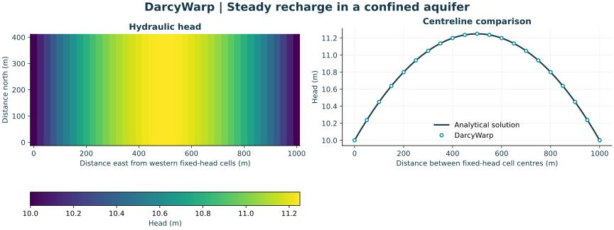

# DarcyWarp

**Fast structured groundwater flow on CPUs and NVIDIA GPUs.**

[](https://github.com/Lincoln-Environmental/DarcyWarp/actions/workflows/ci.yml)
[](LICENSE)

[Quick start](#quick-start) · [Capabilities](#what-darcywarp-does) · [Documentation](#documentation) · [Validation](#validation-and-performance) · [Contributing](CONTRIBUTING.md) · [Citation](#citation)

DarcyWarp solves saturated groundwater flow using [NVIDIA Warp](https://github.com/NVIDIA/warp).
It supports confined and unconfined aquifers, steady and transient simulations,
and repeated solves with changing recharge or aquifer properties. The repository
includes the solver, small reproducible examples, MODFLOW 6 comparisons and
ensemble benchmarks.

DarcyWarp provides **two-dimensional horizontal flow on a square-cell grid** and
**three-dimensional flow on structured Cartesian and layered DIS grids**. The
3D solver includes a legacy Cartesian formulation and an explicit MF6 6.6.2
NPF/STO formulation. See the [3D guide](docs/3D_CARTESIAN_NPF.md) for setup,
solver selection and validation scope. The [3D implementation guide](docs/3D_IMPLEMENTATIONS.rst)
covers solver selection and reproduction. The
[initial GPU release notes](docs/3D_GPU_RELEASE_NOTES.md) preserve
the historical qualification and its original runtime comparisons.

The [NPF transient GPU guide](docs/NPF662_GPU_NATIVE.rst) describes the opt-in
device acceptance and persistent hierarchy implementation, including
convertible benchmarks, conductivity updates and reproduction commands.
The [current NPF GPU performance guide](source/npf_gpu_native.rst) summarizes
the accelerated 3D transient history on `main`. For 500 x 500 x 5 cells
over 20 weekly steps, the explicitly selected fast profile recorded
**0.972 s versus 104.391 s** for convertible NPF/STO (about 107x) and
**1.378 s versus 346.408 s** for confined NPF/STO (about 251x).
These comparisons measure the synchronized DarcyWarp GPU history API
against one saved MODFLOW 6 engine run. External model construction and
independent benchmark audits are reported separately.
Those original performance cases have no GHB.

[Native 3D GHB](docs/3D_NATIVE_GHB.rst) adds cell-based general-head boundaries
to Cartesian and NPF/STO, including steady/transient CPU/CUDA and live MF6
checks. The guide documents the build/update API, boundary budgets, the faster
Cartesian FGMRES option and reproducible `run_3d_sanity.py --ghb` commands.
All six large GHB cases pass and outperform matching MF6 runs. With the
explicit FP64 roundoff profile, convertible NPF takes **1.819 s versus
142.638 s MF6** for twenty steps on 500 x 500 x 5 cells. The release report
contains all steady/transient timings, accuracy measurements and controls.

The [2D GPU release notes](docs/2D_GPU_RELEASE_NOTES.rst) cover the parallel
reductions, faster transient profile and GHB parity repairs, with fresh
before/after main benchmarks and unchanged convergence gates. The profile is
explicitly selected using
[`2d_transient_runtime_controls.json`](working_tests/2d_transient_runtime_controls.json).

**Developed by Patrick Durney and Jaco Fourie at [Lincoln Agritech Ltd](https://lincolnagritech.co.nz/), which owns the DarcyWarp software.** DarcyWarp is released under the [GNU Affero General Public License v3.0 or later](LICENSE).

## Synthetic groundwater verification example



*A small confined aquifer with uniform recharge, fixed heads at its two ends and
no flow across its sides. The figure is generated by the [example below](#quick-start);
it shows a numerical solution and its analytical reference, not field observations.*

## What DarcyWarp does

| Formulation | Grid | Supported physics and modes | Solvers |
| --- | --- | --- | --- |
| 2D thickness-integrated | Square cells, `(ny, nx)` | Confined or unconfined, steady or transient; general-head exchange | PCG, K-cycle, Picard, semismooth Newton; experimental FAS |
| 3D legacy Cartesian | Uniform layers, `(nz, ny, nx)` | Confined or unconfined, steady or transient; native GHB | Classic and fast K-cycle; opt-in confined FGMRES |
| 3D MF6 6.6.2 NPF/STO | Uniform Cartesian or layered DIS, `(nz, ny, nx)` | Confined or convertible, steady or backward-Euler transient Ss/Sy; native GHB | GMRES or K-cycle-preconditioned FGMRES; opt-in device-resident transient history |

All formulations run on CPU or NVIDIA CUDA using Warp and support active-cell
and fixed-head masks. The 3D source is a *volumetric rate per cell*, whereas
the 2D source is an *areal recharge or withdrawal rate*. Mixed precision is
explicitly selected and retains FP64 physical acceptance in the qualified
fast NPF history. Library defaults are unchanged.

See [2D solver selection](source/capabilities.rst),
[structured 3D models](docs/3D_CARTESIAN_NPF.md) and
[current 3D NPF GPU execution](source/npf_gpu_native.rst) for API and
validation details. Transformed terrain remains experimental on `dev`.

## Quick start

### 1. Create the environment

From a terminal with Conda available:

```bash
git clone --depth 1 https://github.com/Lincoln-Environmental/DarcyWarp.git
cd DarcyWarp
conda env create -f environment.yml
conda activate darcywarp
```

The environment installs the numerical and plotting dependencies, Sphinx,
and the pip dependencies in [requirements-pip.txt](requirements-pip.txt).
NVIDIA Warp is distributed as `warp-lang` and imported as `warp`; this repository
pins `warp-lang==1.17.0` for the NPF Krylov backend. CPU release checks
use Python 3.12. Run the commands below from the repository root.

### 2. Run a small model

```bash
python -m examples.steady_recharge
```

This example builds a small confined aquifer, solves it on the CPU and checks
the result against an analytical head profile. It uses explicit SI units and
does not require MODFLOW 6 or external data.

Results are saved in `outputs/steady_recharge/`:

| File | Contents |
| --- | --- |
| `steady_recharge.npz` | Model inputs, simulated and analytical heads, and coordinates. |
| `steady_recharge.png` | Groundwater head map and comparison profile. |
| `steady_recharge.svg` | The same figure in a scalable vector format. |

The first run compiles Warp kernels, so its elapsed time includes setup. Edit the
explicit parameters in [examples/steady_recharge.py](examples/steady_recharge.py)
to change the model or select `device="cuda:0"` on a compatible NVIDIA GPU.
The [quickstart guide](source/quickstart.rst) explains the geometry, equation,
boundary placement and convergence check.

## Build your own model

Use the public factory, `DARCY_WARP_PACKAGE.create_solver`, to construct a model,
then supply NumPy arrays for aquifer properties, recharge, the active domain and
boundary conditions. The [worked example](examples/steady_recharge.py) shows the
complete build, solve, check and cleanup sequence.

Use `create_solver(dim=3, ...)` or the public `WarpDarcySolver3D` class for
3D models. Run `DARCY_FLOAT=float64 python -m examples.verify_3d_series_flow`
for an analytical layered NPF check on CPU.

For other formulations, start with the [capability guide](source/capabilities.rst)
and the [confined/transient](tests/test_2d_transient.py) or
[unconfined](tests/test_2d_unconfined.py) examples exercised by the test suite.
Keep units consistent across conductivity, transmissivity, recharge, storage
and simulation time. Inspect convergence diagnostics and water balance for the
case being modelled.

## Validation and performance

The repository contains analytical checks, independent CPU comparisons,
MODFLOW 6 comparison drivers, transient storage and water-balance checks, and
tests of solver selection and precision. The [validation guide](source/validation.rst)
maps these checks to their source files and explains how to reproduce them.

The small example above checks a simple confined case. Existing comparison
datasets and benchmark summaries record particular configurations; they do not
establish accuracy or runtime for every model or solver setting. Site models
still require appropriate conceptualisation, boundary conditions and calibration
or evaluation against observations.

### Run an ensemble benchmark

For example, run the Warp recharge and transmissivity suites after the quick start:

```bash
python -m DARCY_WARP_PACKAGE.bench_and_plot \
  --run_warp \
  --nx 1000 --ny 1000 --dx 100.0 \
  --n_cases 48 --seed 42 \
  --device cuda:0 \
  --out_dir outputs/benchmarks
```

This is a GPU benchmark, separate from the small CPU introduction. MODFLOW 6
comparisons also require an `mf6` executable. The wrapper creates comparison
plots only when an MF6 summary is available; check that its configuration matches
the Warp run before using the plots. See the
[benchmark guide](source/benchmarking.rst) for CPU reference runs, worker counts,
precision choices, output files and cache behaviour. Compare timings only with
the grid, hardware, precision, convergence criteria and setup costs identified.

## Documentation

| Guide | Start here for |
| --- | --- |
| [Quickstart](source/quickstart.rst) | Installation and a complete first model. |
| [Capabilities and solver selection](source/capabilities.rst) | 2D formulations, backend choices, boundaries, precision and limitations. |
| [Structured 3D models](docs/3D_CARTESIAN_NPF.md) | Cartesian/layered DIS, NPF/STO and the device-resident history API. |
| [Current 3D GPU performance](source/npf_gpu_native.rst) | Verified 20-step GPU/MF6 timings, controls, acceptance and timing scope. |
| [Validation](source/validation.rst) | Analytical checks, numerical comparisons and their scope. |
| [2D GPU release](docs/2D_GPU_RELEASE_NOTES.rst) | Runtime profile, GHB parity fixes, current main timings and reproducible GPU checks. |
| [Benchmarking](source/benchmarking.rst) | Ensemble workflows, flags, generated files and troubleshooting. |
| [Build the documentation](source/docs_build.rst) | A local HTML documentation site. |
| [Contributing](CONTRIBUTING.md) | Development checks and useful issue reports. |

Build the HTML documentation with:

```bash
python -m sphinx -b html source build/html
```

Then open `build/html/index.html`. The equivalent Make target is `make docs`.

## Related work

[FloodWarp](https://github.com/Lincoln-Environmental/floodwarp) provides
two-dimensional surface-water and flood modelling. DarcyWarp focuses on
groundwater. Each repository documents its own numerical scope and workflows.

## Citation

The original method is described by **Durney and Fourie (2026)** in
*Environmental Modelling & Software*, **204**, 107081:
[DarcyWarp: a GPU-accelerated multigrid solver for repeated 2D groundwater solves](https://doi.org/10.1016/j.envsoft.2026.107081).

The paper covers the steady, fixed-transmissivity solver. Transient, unconfined
and subsequent precision/performance developments have their own checks in the
repository; the paper's results should be read within its original scope.

If you use DarcyWarp in research, cite the paper and record the exact software
commit or release used. [CITATION.cff](CITATION.cff) provides the software and
paper metadata recognised by GitHub's **Cite this repository** menu. Describe
the formulation, solver, precision and convergence settings alongside your results.

## Development, ownership and acknowledgements

DarcyWarp was developed by **Patrick Durney and Jaco Fourie** at
**[Lincoln Agritech Ltd](https://lincolnagritech.co.nz/)**.
**The software is owned by Lincoln Agritech Ltd.**

DarcyWarp's `mf6_6_6_2_npf` formulation independently implements selected
NPF (Node Property Flow) and STO (Storage) methods described in **USGS
MODFLOW 6.6.2**, using Python and NVIDIA Warp. MODFLOW 6 is a scientific
reference and validation comparator; DarcyWarp is not an official USGS
implementation or USGS-endorsed software.

The project also includes a modified GMRES implementation adapted from
NVIDIA Warp (Apache-2.0) in `terrain_gmres_3d.py`.

See [third-party acknowledgements and licences](THIRD_PARTY_NOTICES.md)
for the MODFLOW 6 software citation and the adapted NVIDIA Warp copyright,
modification notice and licence text. FloPy is used in independent comparison
workflows.

For questions about the code, [open an issue](https://github.com/Lincoln-Environmental/DarcyWarp/issues).
For research enquiries, contact [Patrick Durney](mailto:patrick.durney@lincolnagritech.co.nz).

## Licence

This repository is licensed under the GNU Affero General Public License v3.0 or
later (`AGPL-3.0-or-later`). See [LICENSE](LICENSE) for the full licence text.
