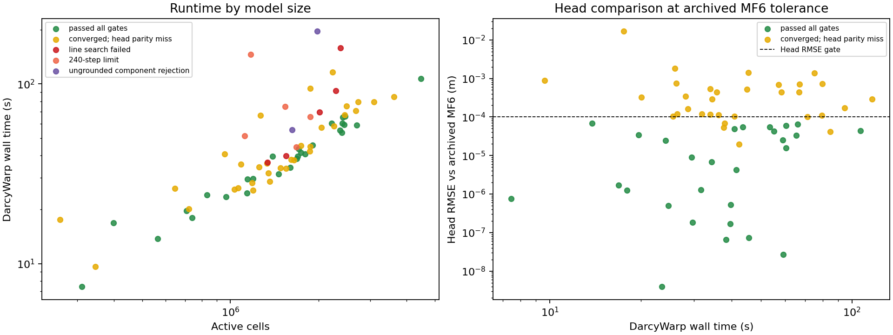

# USGS 74-model CUDA mixed-fast requalification

## Run conditions

All 74 discovered workspaces were run natively with MODFLOW 6.6.2 from copied inputs using archived IMS settings, original package inputs, and original initial heads. The run used no more than 10 CPU cores. DarcyWarp used `dev` mixed-fast CUDA defaults on the RTX 4070 Ti SUPER, started from the original heads, and used the shared steady Newton limit of 240. No acceptance tolerance or physical input was changed. Original-settings native references were reused for this DarcyWarp requalification.

All 74 workspaces are single-layer; active cells range from 261,841 to 4,471,511, and the largest grid has 8,306,826 total cells. This suite does not qualify multilayer behavior.

The per-model CSV contains runtimes, setup times, sampled GPU memory, iteration counts, raw and datum-aligned head differences, face-flow differences, package budgets and physical balance. Per-model spatial maps and JSON receipts remain beside each case in `darcywarp_qualification/`.

## Results

**28/74 passed every unchanged physical and parity gate.** DarcyWarp reached and physically accepted a solution in 60 cases. The head-parity failures converged physically but miss comparison against the archived, comparatively loose native endpoint; they remain unqualified until checked against tighter MF6 endpoints.

| Result | Cases |
|---|---:|
| passed all gates | 28 |
| converged; head parity miss | 32 |
| native-head audit rejected | 2 |
| line search failed | 5 |
| 240-step limit | 5 |
| ungrounded component rejection | 2 |

Among fully accepted cases, median native runtime was 91.1 s, median DarcyWarp wall runtime 39.6 s, median numerical solve time 1.68 s, and median paired DarcyWarp/native wall-time ratio 0.422. Maximum sampled GPU use over all cases was 11634 MiB. Runtime comparisons are reported only for the fully accepted subset.

## Remaining findings

The five line-search / Newton-limit / ungrounded-component groups are genuine solver failures; no gate was relaxed. The two native-head audits reject individual DRN exchange differences at high-conductance entries by about one saved-head ULP, just above the unchanged per-entry absolute gate. The detailed native-head receipts retain the offending entries.

Prior tight-reference evidence records 23 head-comparison cases passing all existing gates against tighter MF6 endpoints; controlled 240-step comparisons also validated 1015 and 1308. Separate `dvclose=1e-6` runs are now in progress for 1025, 1103, 1109, 1205 and 1602. Case 1805 also reached a new endpoint and still needs tight-reference confirmation. Earlier tight attempts for 1109 and 1501 were manually stopped after poor MF6 contraction, so those head comparisons remain unresolved. No claim that every archived-reference mismatch is resolved is made here.

### DarcyWarp solver failures

- `1018_1019_MF6_SS_Unconfined_250`: RuntimeError: DarcyWarp failed at period 1, step 1: line_search_failed
- `1102_1108_MF6_SS_Unconfined_250`: RuntimeError: DarcyWarp failed at period 1, step 1: line_search_failed
- `1210_1211_MF6_SS_Unconfined_250`: RuntimeError: DarcyWarp failed at period 1, step 1: outer_budget
- `1304_1307_MF6_SS_Unconfined_250`: RuntimeError: DarcyWarp failed at period 1, step 1: ungrounded_saturation_components
- `1404_1405_1406_MF6_SS_Unconfined_250`: RuntimeError: DarcyWarp failed at period 1, step 1: line_search_failed
- `1502_1506_MF6_SS_Unconfined_250`: RuntimeError: DarcyWarp failed at period 1, step 1: outer_budget
- `1503_1507_MF6_SS_Unconfined_250`: RuntimeError: DarcyWarp failed at period 1, step 1: line_search_failed
- `1504_1505_1508_MF6_SS_Unconfined_250`: RuntimeError: DarcyWarp failed at period 1, step 1: outer_budget
- `1606_MF6_SS_Unconfined_250`: RuntimeError: DarcyWarp failed at period 1, step 1: ungrounded_saturation_components
- `1801_1802_1808_MF6_SS_Unconfined_250`: RuntimeError: DarcyWarp failed at period 1, step 1: line_search_failed
- `1807_1810_MF6_SS_Unconfined_250`: RuntimeError: DarcyWarp failed at period 1, step 1: outer_budget
- `1809_MF6_SS_Unconfined_250`: RuntimeError: DarcyWarp failed at period 1, step 1: outer_budget

### Converged states missing archived MF6 head gates

- `0308_0309_0310_MF6_SS_Unconfined_250`: RMSE 0.0001172 m; maximum 0.005454 m.
- `0403_0404_0707_0709_0712_MF6_SS_Unconfined_250`: RMSE 0.0004362 m; maximum 0.01877 m.
- `0405_0409_0410_MF6_SS_Unconfined_250`: RMSE 0.0003454 m; maximum 0.009107 m.
- `0406_0407_0408_0416_MF6_SS_Unconfined_250`: RMSE 0.0004365 m; maximum 0.009425 m.
- `0414_0415_MF6_SS_Unconfined_250`: RMSE 0.0001028 m; maximum 0.008364 m.
- `0501_0502_0503_MF6_SS_Unconfined_250`: RMSE 0.0001178 m; maximum 0.005456 m.
- `0504_0506_0508_0509_MF6_SS_Unconfined_250`: RMSE 0.0001046 m; maximum 0.01052 m.
- `0511_0513_0514_MF6_SS_Unconfined_250`: RMSE 5.301e-05 m; maximum 0.007339 m.
- `0512_MF6_SS_Unconfined_250`: RMSE 0.0001604 m; maximum 0.008999 m.
- `0711_0713_0714_MF6_SS_Unconfined_250`: RMSE 1.938e-05 m; maximum 0.01625 m.
- `0804_0805_0808_MF6_SS_Unconfined_250`: RMSE 6.782e-05 m; maximum 0.009845 m.
- `0901_0902_0903_MF6_SS_Unconfined_250`: RMSE 0.0007013 m; maximum 0.03364 m.
- `0904_1002_1003_1004_1005_1007_MF6_SS_Unconfined_250`: RMSE 4.14e-05 m; maximum 0.008638 m.
- `1006_1010_1011_MF6_SS_Unconfined_250`: RMSE 0.001412 m; maximum 0.05233 m.
- `1008_1009_1012_MF6_SS_Unconfined_250`: RMSE 0.0007286 m; maximum 0.01894 m.
- `1015_1020_1021_1022_1023_MF6_SS_Unconfined_250`: RMSE 0.0002907 m; maximum 0.008269 m.
- `1016_1017_MF6_SS_Unconfined_250`: RMSE 0.0005343 m; maximum 0.01779 m.
- `1025_1026_1027_MF6_SS_Unconfined_250`: RMSE 0.001367 m; maximum 0.01915 m.
- `1103_1104_1105_1106_MF6_SS_Unconfined_250`: RMSE 0.0006844 m; maximum 0.01154 m.
- `1109_1110_1112_1113_MF6_SS_Unconfined_250`: RMSE 0.000109 m; maximum 0.002839 m.
- `1201_1202_1203_1204_MF6_SS_Unconfined_250`: RMSE 0.0005265 m; maximum 0.08299 m.
- `1205_1208_MF6_SS_Unconfined_250`: RMSE 0.0004397 m; maximum 0.004487 m.
- `1308_1309_MF6_SS_Unconfined_250`: RMSE 0.01665 m; maximum 0.162 m.
- `1403_MF6_SS_Unconfined_250`: RMSE 0.0008909 m; maximum 0.03783 m.
- `1408_MF6_SS_Unconfined_250`: RMSE 0.001836 m; maximum 0.0295 m.
- `1501_MF6_SS_Unconfined_250`: RMSE 0.0002924 m; maximum 0.006378 m.
- `1602_1603_MF6_SS_Unconfined_250`: RMSE 0.000171 m; maximum 0.006213 m.
- `1701_1702_1703_MF6_SS_Unconfined_250`: RMSE 0.0001003 m; maximum 0.00433 m.
- `1708_1711_1713_MF6_SS_Unconfined_250`: RMSE 0.0001197 m; maximum 0.0115 m.
- `1712_MF6_SS_Unconfined_250`: RMSE 0.000321 m; maximum 0.008816 m.
- `1803_1804_MF6_SS_Unconfined_250`: RMSE 0.0001117 m; maximum 0.03327 m.
- `1805_1806_MF6_SS_Unconfined_250`: RMSE 0.0007424 m; maximum 0.04827 m.

### Native-head audit rejections

- `1301_1302_MF6_SS_Unconfined_250`: RuntimeError: native_heads parity failed: DRN: native entry exchange; see /home/patrickdurney/PycharmProjects/DarcyWarp/benchmark_results/usgs_full_suite_20261128/darcywarp_qualification/1301_1302_MF6_SS_Unconfined_250/native_heads.json
- `1303_1305_1306_MF6_SS_Unconfined_250`: RuntimeError: native_heads parity failed: DRN: native entry exchange; see /home/patrickdurney/PycharmProjects/DarcyWarp/benchmark_results/usgs_full_suite_20261128/darcywarp_qualification/1303_1305_1306_MF6_SS_Unconfined_250/native_heads.json

Acceptance thresholds remain head maximum 0.005 m, head RMSE 1e-4 m, saturation thickness 0.1 m, flow absolute 1e-6 and relative 1e-10, and gross package-budget relative 1e-3.

See [`darcywarp_qualification/usgs_regional_results.csv`](darcywarp_qualification/usgs_regional_results.csv) for all 74 records.

## Targeted follow-up to `20d4381`

Saved receipts establish 55 distinct fully qualified workspaces, including
1801 from this follow-up. The 28 archived-reference passes and 27
tighter-reference passes are disjoint. Six additional DarcyWarp solutions
passed the physical checks and still need sufficiently accurate MF6
comparisons.

The two native DRN audits now pass with the cached MF6 outputs. The saved
rates match the expanded expression `C*z - C*h` exactly. The independent
factored expression differed by at most 1.4833e-6 m³/day in 1301 and
1.2065e-6 m³/day in 1303. The audit uses a per-entry bound on the rounding
of these operations. The newly unblocked DarcyWarp runs from original
heads took 70.8 and 78.7 s, respectively, and both ended with three
ungrounded saturation components.

The initial Newton directions for 1304 and 1606 reduced the physical
residual at small steps. Maximum corrections of 67,382 m and 1,363,259 m
restricted the step taken across each grid. In 1606 the worst row was
nearly dry, with a current Newton diagonal of 53.9 and a full-saturated
scaling diagonal of 47,803 m²/day. The drying guard changed none of the
heads in the small-step comparisons. In 1304, increasing the correction
shift in high-conductance rows cut the first maximum correction to
1,566 m and the 240-step physical RMS residual from 2,670 to 11.9 m³/day.
Two ungrounded components remained after 184.4 s. Each was a single
recharged cell with zero flow paths. The cached MF6 heads put the two
cells 0.43 and 0.23 mm above their bottoms, where they can pass the
recharge onward. A fully saturated preliminary solve stopped at its
line search after 13 steps and yielded no starting guess.

At the 1102 rejected state, the scaled Newton solve met its linear
target with a 72% defect in the physical norm. Physical weighting cut
that defect to 0.98%, but the tested trial steps still increased the
physical residual. At the 1801 rejected state, physical weighting
changed the initial slope of the squared physical residual from +0.520
to −1.987, normalized by its starting value.

A subsequent 1801 run reached a relative flow imbalance of 1.6e-11
but stopped after 285.6 s with a head-equivalent RMS error of 0.022 m.
Projecting three unforced, nearly dry cells to their bottoms cleared the
head-error check. The existing scaled solve still stalled on the
cell-by-cell flow check. From that saved projected state, physical
weighting cleared the unchanged physical gates in two steps with a
head-equivalent RMS error of 9.7e-11 m.

With the corrected solver, 1801 passed the physical checks from its
original heads in 142 Newton steps and 132.6 s, including 78.4 s in
Newton and 7,933 CUDA graph replays. Its final head-equivalent RMS
error was 9.8e-11 m and its relative cell imbalance was 1.2e-12.
The archived MF6 comparison missed only the two head gates. A new
MF6 reference at `dvclose=1e-6` took 135.4 s. The same DarcyWarp heads
passed every comparison gate against that reference, with datum-aligned
RMSE 4.02e-8 m and maximum difference 9.00e-6 m.

## Targeted MF6 Newton-guard qualification

The documented follow-up tally was 55 fully qualified, six awaiting a tight
MF6 comparison, and 13 solver failures. Four of those solver failures now
pass all gates from the archived initial heads. The tally is **59 fully
qualified, six awaiting tighter comparisons, and nine solver failures**.
The remaining failures are 1301, 1303, 1404, 1502, 1503, 1504, 1606, 1807,
and 1809. These are targeted results, with no full-suite rerun.

| Model | MF6 reference | DarcyWarp wall s | Newton / Krylov | Relative cell imbalance | Head RMSE m | Head maximum m |
|---|---|---:|---:|---:|---:|---:|
| 1018 | `dvclose=1e-6` | 91.7 | 112 / 2131 | 1.23e-10 | 1.09e-7 | 4.83e-6 |
| 1102 | archived | 63.8 | 168 / 3854 | 9.20e-12 | 7.16e-5 | 4.77e-3 |
| 1210 | `dvclose=1e-6` | 56.0 | 79 / 1224 | 9.79e-13 | 2.33e-7 | 1.58e-6 |
| 1304 | archived | 185.3 | 239 / 16181 | 8.78e-10 | 4.83e-5 | 9.86e-4 |
| 1801 regression | cached `dvclose=1e-6` | 106.7 | 44 / 5450 | 1.35e-12 | 4.02e-8 | 9.00e-6 |

The 1018 and 1210 tight references took 1233.5 and 736.2 seconds. Their
DarcyWarp solutions were reused for comparison. Their reports are in
`remaining_20d4381/regional_tight_comparison/`. The original DarcyWarp
reports for 1018 and 1102 are in `remaining_20d4381/refinement_krylov_budget/`.
The 1210 DarcyWarp report is in `remaining_20d4381/spatial_refinement_pending/`.
The 1304 and 1801 CUDA reruns, audits, and 1304 accepted-iterate trace are in
`remaining_20d4381/mf6_guard_c8553b7ba7fa/`. The 1304 wall time includes
recording the two-cell trace. The 1801 run used the dry projection and
replayed its mixed-fast K-cycle graph 5450 times.

Both 1304 and 1801 explicitly request `NEWTON UNDER_RELAXATION`. The importer
now enables the column-bottom rule from that option. A NEWTON-only
single-cell test with GHB inflow balancing a 2 m³/day well reaches −1 m
from a 1 m wet start. An exact or rounded-to-bottom trial still preserves
an isolated previously wet recharge outlet. A trial one representable value
above bottom retains that value.

Neither 1304 cell changed its four positive lateral connections on any
accepted iterate. The minimum wet thicknesses were 9.91e-9 m and
1.14e-12 m, respectively. Both drains stayed inactive at the endpoint.
Cell indices are zero-based in layer, row, column order.

| Cell | Starting wet thickness m | First accepted connectivity change | Final wet thickness mm | Recharge m³/day | Net face outflow m³/day | Local residual m³/day |
|---|---:|---|---:|---:|---:|---:|
| (0, 580, 758) | 29.54957 | none | 0.428511 | 3.61271395625 | 3.61271395712 | −8.71e-10 |
| (0, 504, 714) | 48.29021 | none | 0.228234 | 3.22035316250 | 3.22035316041 | 2.09e-9 |

### Saved-state and MF6 safeguard diagnostics

The archived IMS files for the remaining steady convertible cases use
`COMPLEX`. MF6 6.6.2 applies delta-bar-delta to the raw correction, adjusts
below-bottom heads when requested, and backtracks along the resulting step.
The preset reduces the weight by 0.8 on a sign reversal, restores it by
0.0001 otherwise, and backtracks by a factor of 0.1 when the flow norm grows
by more than 5%. It repairs a near-zero linear diagonal before adding the
steady pseudo-transient shift. GWF starts that shift from the maximum
absolute cell residual divided by cell volume. These are numerical
correction rules. [MF6 numerical solution](https://github.com/MODFLOW-ORG/modflow6/blob/6.6.2/src/Solution/NumericalSolution.f90) · [MF6 GWF model](https://github.com/MODFLOW-ORG/modflow6/blob/6.6.2/src/Model/GroundWaterFlow/gwf.f90)

On the saved 1102 failure, the spatially shifted Newton solve with physical
Krylov weighting used 39 iterations and left 461 for recovery. The full
trial clipped 57 cells and raised flow RMS from 5.246 to 60.649 m³/day.
The accepted one-eighth trial clipped four cells and reduced RMS to
4.977 m³/day. This replay did not exhaust the fallback budget.

At the previously identified 1606 row `(0, 1599, 775)`, the spatial shift
was 956.05 m²/day against a current Newton diagonal of 53.89 m²/day. Its
full-saturated principal diagonal was 47,802.57 m²/day and the grid median
was 277.17 m²/day. The MF6 residual-based initial shift computed from the
archived heads was 0.105324. Testing the MF6 relaxation sequence with that
shift and physical Krylov weighting still ended short of acceptance at
0.293 relative imbalance. A saved-state replay isolated the weighting
issue by reducing imbalance from 0.743 to 0.012 in six steps.

1504 and 1807 remain unqualified. The from-original runs with `cbe5d5d`
reached relative imbalance of 8.07e-5 and 1.25e-4, respectively, before
line-search rejection. The saved 1807 state produced a descending Newton
trial when Krylov used the physical residual. The accepted one-quarter
trial reduced flow RMS from 0.04492 to 0.04289 m³/day and head-equivalent
RMS from 16.10 to 0.02392 m. The replay does not change the qualification
count.

### 1807 original-head convergence with IMS backtracking

The highest-residual cell in the stalled 1807 checkpoint was 27.62 m
above bottom with four conducting faces. Ten neighbours contributed 40%
of the squared flow residual. An independent direct solve of the shifted
Newton matrix reduced the relative linear defect to 5.5e-12, yet the full
trial increased the physical flow norm by a factor of 449,000. Taking
1/128 of the direction reduced the flow norm by only 0.73%.

MF6 6.6.2 stops backtracking when another reduction would take the maximum
head displacement below DVCLOSE. The archived 1807 listing used this exit
at outer 88. Applying it after ordinary descent failed, with physical
Krylov weighting, allowed two Picard recovery steps in the original-head
DarcyWarp run. Independent physical acceptance passed in 204 outers and
43,989 Krylov iterations. Mixed-fast CUDA took 211.13 s including import,
with 177.71 s in the solve. Head-equivalent RMS was 1.90e-10 m and relative
cell imbalance was 1.92e-10.

Only head parity failed against the archived MF6 result, with 0.0014470 m
RMS and 0.0295536 m maximum difference. The last native head change was
0.09367 m. The original-start receipt is under
`remaining_20d4381/ims_head_limit_original_01/1807_1810_MF6_SS_Unconfined_250/`.
The tight MF6 6.6.2 reference at `dvclose=1e-6` finished in 800.37 s.
Both the native-head audit and the saved DarcyWarp solution passed every
gate. Head RMSE was 1.69e-7 m and the maximum difference was 5.30e-6 m.
The comparison receipts are under `remaining_20d4381/regional_tight_comparison/`.
The tally is 60 fully qualified, six more physically accepted awaiting
reference comparison, and eight solver failures.

### 1301 and 1303 after IMS backtracking

Both mixed-fast CUDA runs started from the archived initial heads and
reached the 240-outer limit. The model-specific results below use the
saved head at that limit for each follow-up. Directory names refer to
`remaining_20d4381/`.

| Model | Original run | Follow-up from the saved head |
| --- | --- | --- |
| 1301 | 340.4 s, relative cell imbalance 7.53e-5, head RMSE against cached MF6 0.01563 m | 96 accepted updates reduced flow RMS from 0.03431 to 0.0001722 m³/day and relative imbalance to 3.47e-7. |
| 1303 | 564.1 s, relative cell imbalance 4.26e-8, head-equivalent RMS 0.01709 m | Holding the correction at zero for exactly disconnected, unforced dry rows gave independent physical acceptance in 35 further updates, 8,432 Krylov iterations and 148.0 s including setup. Final head-equivalent RMS was 1.06e-8 m and relative imbalance was 1.48e-9. |

In 1303, cell `(0, 1926, 3)` ended one representable head above bottom in
both solvers. Its flow residual was −2.99e-20 m³/day, but its diagonal of
1.19e-21 m²/day translated that into a 25.15 m head-equivalent error.
After projection to bottom, its residual and all incident flow derivatives
were exactly zero. The linear solver could move this unconstrained head
by roundoff and reopen the cell. The replay held it still only while the
source, residual, package/storage tangent and incident face derivatives
were all zero. The original-start receipts are in
`ims_head_limit_original_01`. Replay receipts are in
`ims_head_limit_continuation_01` and `dry_zero_hold_saved_01`.

### 1606 nonlinear flow and checkpoint results

At a saved 1606 state, a direct diagnostic solve reduced the relative
linear defect to 2.82e-11. The resulting Newton step proposed a 471.6 m
rise at a cell where the cached MF6 head was only 42.64 m higher. Even
1/512 of the step increased the flow residual norm by a factor of 3.15.

A separate check interpolated from a later saved state towards the
cached MF6 heads. Moving 1% of the way increased flow RMS by a factor
of 8.59. Halfway it was 214 times the starting value. At the dominant
cell, the water table rose before the 15.33 m head difference with its
eastern neighbour had flattened. The midpoint combined 22.27 m of wet
thickness with a 7.67 m head difference. This produced about 27,100 m³/day
of eastward flow, compared with 12.6 m³/day at the native endpoint.
Neither the donor cell nor the drain branch changed at that row.

| Saved-state trial | Measured outcome |
| --- | --- |
| Physical Krylov weighting | Two accepted updates reduced relative imbalance from 1.29% to 0.575%. The third line search stalled. |
| Add delta-bar-delta relaxation alone | The second maximum correction fell from 67.90 to 54.32 m. Flow RMS reached 1.5854 m³/day and the third step still stalled. |
| Add adaptive pseudo-transient continuation alone | The shift fell from 5.67e-4 to 1.74e-4. Flow RMS reached 1.5880 m³/day and the third step still stalled. |
| Change the fine and coarse preconditioner | Including the receiving-cell derivative improved the first linear reduction from 0.23% to 0.99%. Using a conservative coarse operator then accepted seven steps, but raw corrections reached 41,340 m and relative imbalance increased from 0.575% to 0.590%. |
| Permit IMS head-change backtracking after the stall | Over 80 updates, head RMSE against cached MF6 fell from 3.154 to 1.923 m. Relative imbalance rose from 0.575% to 0.636%. |
| Continue with adaptive pseudo-transient continuation and IMS backtracking | Over the next 80 updates, flow RMS fell from 1.374 to 0.8524 m³/day, relative imbalance fell to 0.386%, and the final maximum proposed correction was 9.01 m. |

The isolated runs are in `weight_checkpoint_01`, `weight_dbd_only_01`,
`weight_ptc_only_01`, `directed_fine_saved_01` and
`conservative_coarse_saved_01`. The two successive 80-update runs are in
`mf6_backtrack_dvclose_01` and `adaptive_backtrack_continuation_01`.
All three models remain in the eight outstanding original-start solver
failures alongside 1404, 1502, 1503, 1504 and 1809.

A further 1606 continuation (`adaptive_backtrack_continuation_02`) used
the previous endpoint and its saved shift of 0.0003515478833. Through
66 accepted updates in 181.6 s it reduced flow RMS from 0.8524 to
0.3637 m³/day and relative imbalance from 0.386% to 0.137%. The process
terminated with SIGSEGV during the linear solve at update 67. The last
accepted metrics come from the progress log. The most recent saved heads
are still those at the end of `adaptive_backtrack_continuation_01`.

### Dry-cell correction from the original 1303 heads

The steady solver now holds an exactly dry convertible head in place when
its unforced equation and every incident face derivative are zero. The
original-head CUDA run reached 240 outers in 611.6 s with 48,503 Krylov
iterations. Head-equivalent RMS fell from 0.01709 m in the previous run to
4.57e-8 m. Relative imbalance fell from 4.26e-8 to 4.81e-9. Both device
and independent calculations still rejected local water balance. Maximum
cell flow error was 0.001906 m³/day, and 100 of 2,164,867 cells accounted
for 98.54% of the squared flow error. The receipt is under
`remaining_20d4381/hold_dry_zero_original_01`.

For 1301, 48 further updates from the previous checkpoint used square-root
diagonal scaling for Newton and measured the true linear defect in flow
units. Flow RMS fell from 1.72e-4 to 2.64e-5 m³/day, and relative
imbalance fell from 3.47e-7 to 5.85e-8. The first scaled Newton solve
reduced its weighted defect by 13.7% but increased its physical defect by
2.0%. The existing physical check rejected that direction. The receipt is
under `remaining_20d4381/equilibrated_refinement_01`. These two runs leave
the qualification tally at 60 full passes, six awaiting comparison and eight
solver failures.

### 1404 passes the physical solve from original heads

With `97b95e4`, 1404 passed independent physical acceptance in 98 Newton
updates and 10,477 Krylov iterations. Every accepted update reduced the
physical flow norm. Solve time was 97.32 s and total time including import
was 148.48 s. Head-equivalent RMS was 1.05e-8 m and relative cell
imbalance was 4.94e-11. Only the two head gates failed against the archived
MF6 output, with RMS difference 0.0005307 m and maximum 0.02089 m. The
archived MF6 final change was 0.09531 m. The saved DarcyWarp endpoint and
comparison are in `remaining_20d4381/97b95e4_original/1404_1405_1406_MF6_SS_Unconfined_250/`.
Pending the tighter comparison, the tally is 60 fully qualified, seven
physically accepted awaiting comparison, and seven solver failures.

### Linear and nonlinear limits at the saved heads

- In 1303, the 16-by-16 block containing the largest flow residual has an
  aggregate Newton diagonal of 167,059 m²/day. The symmetric approximation
  gives 1,032,549 m²/day because 865,491 m²/day of internal saturation
  derivatives are counted as restraint. Removing this term only on the
  coarse levels gave independent physical acceptance after 25 checkpoint
  steps (6,147 Krylov iterations, 126.18 s including import). Including
  directed transfers on the fine grid as well ended at 4.05% relative
  imbalance after 32 steps. A sub-millimetre Picard recovery in the first
  replay increased the physical norm from 0.0110 to 129.0 m³/day.
- The unshifted, accurately solved 1303 Newton direction at the original
  run's rejected endpoint had relative linear defect 6.02e-12 and maximum
  displacement 0.640 mm. Taking the full step reduced the nonlinear flow
  norm by 97.45%. In 1301 the coarse diagonal at the largest residual
  was only 6.29% above the aggregate Newton diagonal.
- On 1606, cellwise DBD with adaptive continuation reduced the largest
  individual recovery spike. At update 64 it had used 49 backtracking
  recoveries and reached 0.373% relative imbalance. Continuation alone
  from the same initial heads and shift used three recoveries and reached
  0.144% at the same update. The DBD receipt is under
  `remaining_20d4381/adaptive_backtrack_dbd_saved_01`.

### Local water balance and fallback steps

At the original 1303 endpoint under `97b95e4`, 65 cells failed local
water balance. They accounted for 94.4% of the squared flow residual. The
worst error was 0.0019064 m³/day against its 0.0006449 m³/day allowance.
Continuing from those heads passed the independent check after 14 full
Newton steps and 3,376 Krylov iterations (36.82 s solve, 101.02 s total).
Every step reduced flow error, so this replay provides a baseline for
testing changes to the preconditioner. Including directed Newton face
transfers on every multigrid level reproduced the independently calculated
coarse diagonal of 167,059 m²/day. On the same heads the resulting
preconditioner missed acceptance after 32 updates and 10,698 Krylov
iterations. The receipts are in `deferred_backtrack_01` and
`conservative_hierarchy_01` under `remaining_20d4381`.

On 1301, retaining the previous restart correction within the existing
Krylov budget reduced flow RMS from 2.64e-5 to 9.61e-6 m³/day over 48
additional checkpoint updates. Eight cells still failed local balance.
The worst had an error of 0.001022 m³/day against 0.0008974 m³/day
allowed. The receipt is in `restart_refinement_02`.

On 1606, starting from the same heads and continuation shift,
trying the remaining fallback directions before accepting an uphill
head-limited step reduced the relative imbalance at update 64 from
0.001622 to 3.95e-6 (146.98 s solve, 198.37 s total for the latter).
Neither endpoint passed. At the improved endpoint, an independent solve
of the unshifted Newton equation had relative linear defect 3.36e-12.
The full step increased the flow norm by a factor of 7.74. The cell with
the largest resulting flow error started 0.2354 m above bottom and its
head fell 0.2068 m. The original heads were used for the 1502 run under
`97b95e4`, which reached 240 outers and 44,791 Krylov iterations in
315.67 s with relative imbalance 9.84e-5. The subsequent 1503 run
stopped during a Warp CUDA readback at outer 205. The last accepted
update had relative imbalance 0.04053. These results leave seven
original-start solver failures.

### 1404 qualifies against tight MF6

Both the native audit and the original-head DarcyWarp solution passed
all gates against MF6 6.6.2 at `dvclose=1e-6`. The tight reference took
1,887.52 s. Head RMSE was 1.79e-7 m and maximum difference was 1.17e-5 m.
The comparison reused the 148.48 s DarcyWarp run. The receipts are in
`remaining_20d4381/regional_tight_comparison/1404_1405_1406_MF6_SS_Unconfined_250`.
This brings the tally to **61 fully qualified, six physically accepted
awaiting comparison, and seven original-head solver failures**.

1606 passed independent physical acceptance from the saved head in
`deferred_backtrack_01` after 45 further updates and 12,026 Krylov
iterations (119.54 s solve, 171.50 s including import). Head-equivalent
RMS was 9.95e-7 m and relative imbalance was 4.23e-9. Only the head
comparisons failed against the archived MF6 output, with RMS difference
0.0001970 m and maximum 0.01565 m. The last archived MF6 head change was
0.09557 m. The saved-head receipt is in `deferred_backtrack_continuation_01`.
An original-head run is still required for qualification.

On 1503, an accurate unshifted Newton solve at the saved
`physical_mf6_drain_damping` endpoint had relative linear defect 3.30e-10.
Cell (0, 568, 931) was 8.882 m below a drain of conductance 4.875e6 m²/day.
Its proposed 347.72 m rise generated 1.652e9 m³/day of drain outflow.
Archived MF6 had the water table just 2.022 mm above that drain.
A diagnostic using only the archived open/closed drain flags changed 83
branches and cut the maximum correction from 347.8 m to 44.15 m. The full
step still increased the flow norm by a factor of 2,848. Neither the
diagnostic flags nor MF6 heads were used to initialise a DarcyWarp run.

On 1303, the trial that deferred uphill fallback steps stopped during a
Warp CUDA-to-host Arnoldi column readback at outer 213. The last accepted
update had relative imbalance 3.53e-5. The same readback stopped 1503 at
outer 205. No new endpoint was recorded for either interrupted run.

### 1606 passes physical acceptance from original heads

Using the normal importer with deferred fallback ordering, 1606 passed
the independent physical checks from archived initial heads in 164 outers
and 35,403 Krylov iterations. The mixed-fast CUDA solve took 351.24 s,
or 585.87 s including import and setup. Head-equivalent RMS was 3.79e-7 m
and relative imbalance was 4.11e-9. Only the two head gates failed against
archived MF6, with 0.0001976 m RMS and 0.01567 m maximum difference.
The receipt is in `remaining_20d4381/deferred_backtrack_original_01`.
This run used the importer's spatial shift. The earlier 45-step checkpoint
used a uniform adaptive shift. The tally is 61 fully qualified, seven
physically accepted awaiting comparison and six original-head solver
failures (1301, 1303, 1502, 1503, 1504 and 1809).

The 1502 history under `97b95e4` records its first uphill Picard step at
outer 124. From outer 123's flow RMS of 0.38045246 m³/day it increased
flow error by a factor of 137.25, with 114 Krylov iterations left. Across
the six uphill steps, five increases were between 130 and 157 times.
Outer 157 had a smaller increase of 18.83 times.

### Original-head continuation and local closure

The uniform adaptive shift used for the successful 45-update 1606
continuation was also tested from the archived initial heads. Both models
used physical Krylov weighting, mixed-fast CUDA, deferred backtracking and
the existing 240-update limit.

| Model | Krylov iterations | Solve time | Final relative water imbalance |
| --- | ---: | ---: | ---: |
| 1303 | 25,206 | 291.86 s | 4.35e-4 |
| 1606 | 9,642 | 100.44 s | 0.708 |

Both runs missed physical acceptance. Their accepted head fields and
continuation states are under `remaining_20d4381/uniform_adaptive_original_01`.
The spatial shift produced better original-head results for both cases.

An independent CPU audit applied a proposed 3 µm local head-equivalent
allowance to hydraulically anchored cells. With all other gates held at
their qualification settings, the saved 1303 original-head endpoint and
the saved 1301 continuation both passed physical acceptance. At the
existing 1 µm allowance they missed in 65 and eight cells, respectively.
The 1303 original-head field differed from its strictly accepted continuation
by 3.19e-6 m RMS and 4.62e-4 m maximum over 2,164,867 active cells.
Relative water imbalance was 4.81e-9 for 1303 and 1.32e-8 for 1301,
compared with 2.12e-6 and 2.03e-6 at the archived MF6 heads. Adoption of
the new regional allowance awaits tight MF6 parity. The 1301 continuation
is diagnostic. The qualification count is unchanged.

### Preserve the archived heads at Newton startup

For 1303 the old startup moved 1,550 disconnected cells to their drain
elevations. The median shift was 65.0 m and the largest was 150.0 m.
The physical flow-error norm rose from 2.754e6 to 3.899e8 m³/day.
At cell (0, 1747, 612), a lift from 1445.14 to 1595.14026 m produced
a residual of −1.117e8 m³/day and a drain flow of only 2.13e-6 m³/day.

Steady convertible solves using a continuation shift now enter Newton at
the supplied heads. Checking the actual normal-importer Newton inputs on
1303 found zero differences across all 2,164,867 free cells. The initial
flow-error norm was 2,753,937.04 m³/day, matching the archived-head
calculation. A two-cell regression checks that recharge leaves through
the lateral face while the overhead drain stays closed.

The strict 1301 checkpoint continued with the same restarted Krylov method.
One update with 112 iterations brought its worst local error from 1.139
to 0.983 times the allowance. All eight previously failing cell IDs and
their individual ratios are in `restart_refinement_continuation_01`.
Independent physical acceptance took 1.16 s of solve time and 40.31 s
including setup. The archived MF6 comparison missed only the two head gates.

### 1502 matched replay before the first uphill step

The accepted head at outer 123 was reconstructed once from original heads.
Both paths produced the same Picard trial, bit for bit, at outer 124,
with 114 Krylov iterations left in the 500-iteration budget. Immediate
acceptance used that trial. Deferral used those 114 iterations to try
the full-saturated direction and retained its smaller uphill trial.
The pre-step flow RMS was 0.38045246 m³/day.

| Measured result | Immediate acceptance | Deferred acceptance |
| --- | ---: | ---: |
| Flow RMS at outer 124 (m³/day) | 52.21758 | 44.87190 |
| Cells over their local allowance at outer 124 | 236,007 | 226,722 |
| First outer below pre-spike flow RMS | 153 | 143 |
| Time from the start of outer 124 to recovery, excluding restart setup | 48.2 s | 31.2 s |
| Flow RMS at outer 240 (m³/day) | 0.29369 | 0.15815 |
| Relative water imbalance at outer 240 | 9.835e-5 | 5.350e-5 |
| Cells over their local allowance at outer 240 | 31,033 | 22,210 |
| Cumulative Krylov iterations | 44,791 | 47,951 |

Neither path reached physical acceptance. The immediate replay stopped
during a CUDA stream synchronization at outer 134 and resumed from the
saved outer 128 state. Its final history reproduced the archived endpoint.
A pinned Arnoldi readback buffer did not prevent the crash and was removed.
The two paths and their trial heads are in `fallback_immediate_pair_01`,
`fallback_immediate_resume128_01` and `fallback_deferred_pair_01`.

The 1502 spike was caused by lateral face flow at (0, 1489, 1082).
The Picard trial raised wet thickness from 0.174 mm to 363.603 mm.
The archived MF6 thickness there is 0.273 mm. Outflow through two
downhill faces rose from 4.65 and 3.86 to 13,636 and 11,327 m³/day.
The drain stayed closed. The full-saturated trial had the same worst
cell. Only one drain opened in each trial, accounting for less than
0.00003% of its squared physical residual. At this step all three
Newton directions were discarded on the linear residual before a
nonlinear trial was made.

With the startup correction in `1aef06b`, 1303's CUDA initial field
matched all free input heads bit for bit. The spatial-shift original
run took 357.01 s of solver time and 29,993 Krylov iterations. Flow
RMS fell from 1,871.71 to 3.84 m³/day over 240 damped Newton steps.
Final relative imbalance was 0.02786. The MF6 6.6.2 initial reciprocal
pseudo-time calculated at the supplied heads is 0.050313, compared
with the importer's starting shift of 5.44764.

### Deferred fallback ordering and the 1807 regression control

1807 started with all 1,119,702 free heads unchanged and passed independent
physical acceptance in 204 updates and 42,654 Krylov iterations. The prior
qualified run used 204 updates and 43,989 Krylov iterations. Solver time
was 180.81 s, compared with 177.71 s previously. The new native-head audit
and solution comparison both passed against the cached tight reference.
The raw head difference was 1.54e-7 m RMS and 5.30e-6 m maximum. Receipts
are under `imported_head_tight_comparison_01`. 1807 remains qualified.

The common steady solver retains the best uphill trial head while trying
remaining directions within the original Krylov budget. It restores and
evaluates that head when the alternatives fail. The matched 1502 replay
above and the 1807 control were run with this ordering.

Reducing the spatial shift on 1303 to the MF6 residual-based starting
scale was less effective on identical saved update-96 heads. Over the
next 32 updates the original shift reached flow RMS 20.97 m³/day using
2,477 Krylov iterations. The smaller shift reached 24.01 using 11,468.
The latter's update-128 continuation state is saved under
`spatial_mf6_start_scale_pair_01`.

### Seven holdouts and the 1807 control

The [experiment records](holdout_experiment_records.csv) index the retained solver reports, saved trajectories, MF6 runs, independent comparisons and local diagnostic logs for these cases. A solve can have several records. Filter by model and experiment to see the starting state where recorded, controls, stopping reason, residuals, timing and evidence path. Empty fields mean the source did not supply that measurement. Paths beginning with `/tmp` identify local logs. Those rows include excerpts because the logs are temporary. Earlier sections give the chronological results for cases already closed.

**1606 passed every gate against tight MF6.** The tight native solve took 3,801.25 s and 357 outer iterations. Against the same saved DarcyWarp solution that missed the archived head gates, the tight comparison gave 0.003263 mm RMS and 0.429508 mm maximum. The native-head audit, independent DarcyWarp physical audit, face-flow and package checks passed. The DarcyWarp run took 351.24 s in the solve, 585.87 s including setup. That raises the historical suite tally to **62 qualified, six with independent physical acceptance awaiting adequate native comparison, and six solver failures**. The six solver failures are 1301, 1303, 1502, 1503, 1504 and 1809. The six comparisons outstanding are 1103, 1109, 1205, 1501, 1602 and 1805. The qualified 1606 run used the earlier steady importer with a numerical starting-head adjustment. Reproduction with every free head exactly as supplied is separately outstanding. [Tight native audit](remaining_20d4381/regional_tight_comparison/1606_MF6_SS_Unconfined_250/native_heads.json) · [Tight solution comparison](remaining_20d4381/regional_tight_comparison/1606_MF6_SS_Unconfined_250/solution.json)

| Model | Experiments and measurements | What remains |
| --- | --- | --- |
| 1301 | Accounting for floating-point cancellation in the native drain exchange cleared the audit. The first CUDA solve then reported three ungrounded components. Spatial weighting and absolute flow-balance merit ended at relative imbalances of 0.00678 and 0.00280. A separate 12-step DBD replay reached 0.00283. MF6 head-limited backtracking reached 7.53e-5 in 240 updates. Continuing the saved heads, including equilibration and retaining a correction across FGMRES restarts, progressively reduced the last local errors. Eight of 1,439,153 cells remained above allowance after the second 48-update block. One more update with 112 Krylov iterations, 1.16 s in the solve, reduced the worst ratio from 1.139 to 0.983 and passed strict physical acceptance. The archived comparison gave 0.156 mm RMS and 5.22 mm maximum. | With every free starting head preserved, the original run used 56,808 Krylov iterations in 371.33 s over 240 updates, ending at relative imbalance 0.002084. The strict checkpoint pass and the earlier 3 µm diagnostic audit do not establish qualification from this start. |
| 1303 | The native drain audit cleared by the same entry-specific roundoff analysis. Spatial refinement, MF6 head-limited backtracking, disconnected-row treatment, coarse operators, local patches, starting-head adjustments, two initial continuation scales and DBD were tested. In a cell one floating-point increment above bottom, flow error of 2.99e-20 m³/day divided by a diagonal of 1.19e-21 m²/day appeared as 25.15 m of head error. Holding truly disconnected unforced rows fixed helped. Two saved-state trials passed strict acceptance in 35 and 14 further updates. At the latter starting point, an accurate unshifted Newton solve reduced flow error by 97.45%. Changing only the coarse operator took 25 updates. Changing every level missed in 32. A local patch spread error into adjacent cells and increased the full norm from 0.0111 to 0.0406 m³/day. | The earlier original-input run missed the 1 µm rule in 65 cells, worst 2.956 times allowance. Its saved heads passed the independent 3 µm audit. Continuing to strict closure changed heads by 0.00319 mm RMS and 0.462 mm maximum. Tight MF6 parity is a separate requirement. With all 2,164,867 free starting heads preserved, 240 damped Newton updates reduced flow RMS from 1,871.71 to 3.841 m³/day in 357.01 s. On matched update-96 heads, reducing the initial shift lost ground after 32 updates. DBD initially tied the usual shift but stalled near 19.35 m³/day through update 208. At update 184 the ordinary run was already at 7.78. |
| 1502 | From the identical pre-spike heads and Krylov budget, immediate acceptance of the Picard trial raised flow RMS from 0.38045 to 52.21758 m³/day. Keeping that trial while spending the remaining 114 Krylov iterations on alternatives gave 44.87190. Recovery took 19 updates and 31.2 s versus 29 and 48.2 s. At update 240 relative imbalance was 5.35e-5 versus 9.84e-5, with 22,210 versus 31,033 cells over allowance. At the worst cell wet thickness jumped from 0.174 to 363.6 mm. Two downhill faces went from 4.65 and 3.86 to 13,636 and 11,327 m³/day. The drain remained closed. Three discarded Newton directions produced small physical decreases in replay despite poor linear convergence. | Deferred ordering won the controlled comparison and passed the 1807 control. Neither 1502 path reached acceptance. Retaining a weak Newton direction avoided the first spike in a diagnostic replay. Its sustained rate is the relevant test. Separate CUDA readback crashes also occurred. A pinned readback buffer still crashed at synchronization and was withdrawn. |
| 1503 | The original line search failed at update 123 with relative imbalance 0.269. The refinement-budget trial reached 0.0851, DBD 0.250, a physical steepest-descent fallback 0.0811, head-limited backtracking 0.0210, physical Krylov weighting with backtracking 0.00688, and local drain damping 0.00226. These experiments include saved-state trials. A direct solve accurate to 3.30e-10 relative linear defect proposed a 347.72 m rise across a drain only 8.882 m above the trial's starting head. Full-step flow error increased about 70 million times. Tests covered drain activation prediction, both sides of transitions, trial residual correction, a conservative Jacobian, path-averaged derivatives and the native drain branch pattern. Supplying the native branch pattern diagnostically cut the largest correction to 44.15 m, yet full-step error still increased 2,848 times and the worst error moved to a face. | The later original run crashed during CUDA readback at update 205. After 204 accepted updates its relative imbalance was 0.04053. A debugger run from the recoverable drain-damping checkpoint finished 240 further updates in 8.84 s at 0.00187, without reproducing the crash or passing physics. The transition error and intermittent runtime failure each remain open. |
| 1504 | The baseline exhausted 240 updates at relative imbalance 0.1473. Guard and refinement changes reached 8.07e-5 before line-search failure at 218. Diagonal fallback reached 5.62e-5 at 240. Physical Krylov weighting, a coarse PCG solve and late pseudo-transient continuation gave small gains at the saved state. A trial reduced flow RMS from 0.132495 to 0.132311 m³/day while relative imbalance worsened. A direct Newton solve at 1.68e-10 relative linear defect still proposed 198.77 m and raised full-step flow error roughly 38 million times. Explicit drain correction still raised it about one million times. At 1/256 of the direction the norm improved only 0.25%. | The linear system can be solved accurately at this state. The resulting direction crosses hydraulic transitions and makes little progress at a safe step length. An original run under the updated common ordering and unchanged-start policy is outstanding. |
| 1606 | Early work tested local correction caps, dry lateral connectivity, rowwise shifts, physical Krylov weighting, DBD, adaptive pseudo-transient continuation, fine/coarse operator changes and MF6 backtracking. One row's current diagonal was 53.9 m²/day versus 47,803 when saturated. A direct solve accurate to 2.82e-11 proposed 471.6 m where the native difference was 42.64 m. Even 1/512 of the step raised flow error 3.15 times. Moving just 1% directly toward the native solution increased flow RMS 8.59 times because wet thickness increased while a large lateral gradient remained. Physical weighting, DBD and continuation each stalled at the third update when tested separately at one checkpoint. Continuing with backtracking and adaptive continuation improved over successive blocks of 80, 80 and 66 updates. Combined DBD needed 49 recovery steps in 64 updates versus three without DBD and had worse balance. Deferring uphill acceptance then improved matched 64-step imbalance from 0.001622 to 3.95e-6. A uniform adaptive continuation passed after 45 more saved-state updates, but from archived inputs stopped at 0.708. The spatial shift passed from archived inputs in 164 updates and 35,403 Krylov iterations. | All independent physical and tight MF6 comparison gates passed for the archived-input run. The exact, unchanged-start replication is identified separately above. |
| 1809 | The earlier run ended after 80 updates with ungrounded components and relative imbalance 0.445. The subsequent qualification run exhausted 240 updates and 23,500 Krylov iterations in 146.41 s, at relative imbalance 0.123 and head-equivalent RMS 7.85 m. An earlier serial batch intended to include 1809 stopped in 1503. | No paired experiment yet isolates the controlling mechanism in 1809. The other models' causes cannot be assigned to it from this history. |
| 1807 control | Physical weighting produced descent at a previous rejection. MF6 head-limited backtracking then allowed two Picard recoveries and the original run passed in 204 updates. The archived MF6 heads missed comparison, and the tight native reference passed. After preserving supplied heads and deferring uphill acceptance, all 1,119,702 free starting heads matched the input. The run again passed in 204 updates, 42,654 Krylov iterations and 180.81 s. Datum-aligned tight head differences were 0.000154 mm RMS and 0.00318 mm maximum. | Qualified control. Its repeated pass adds zero to the model count. |

For 1301 the last eight failing cell IDs were 2153030, 2153031, 2154433, 2154434, 2154435, 2155838, 2155839 and 2157242. For 1303 the earlier startup adjustment raised 1,550 dry-cell heads by a median of 65 m and a maximum of 150 m. It increased the initial flow norm from about 2.75 million to 389.88 million m³/day. The startup change in `1aef06b` preserves the supplied steady heads. The change in `4b17878` preserves the actual uphill trial while the solver checks the remaining directions. FGMRES and the multigrid K-cycle remain the inner solver and its usual preconditioner throughout these changes.

The 1502 diagnostic retaining weak Newton directions completed through outer 240 under the debugger. From the same pre-spike state it finished at 0.357886 m³/day flow RMS and relative imbalance 3.2518e-4. Deferred fallback alone reached 0.15815 m³/day and 5.350e-5 at the same outer. The weak-direction rule was withdrawn. The accepted-state trace is in `physical_stalled_recovery_debug_01`.

### Unchanged-start CUDA results before the hierarchy comparison

All five runs below verified every free starting head against the archived input on the device. Times in the table include import and setup. They use five K-cycle levels, mixed-fast precision, CUDA graphs and the deferred fallback ordering.

| Model | Result | Newton updates | FGMRES iterations | DarcyWarp wall s | Relative water imbalance |
| --- | --- | ---: | ---: | ---: | ---: |
| 1809 | Independent physical pass | 73 | 15,826 | 110.36 | 8.60e-10 |
| 1502 | Outer budget | 240 | 44,923 | 317.21 | 5.82e-5 |
| 1503 | Outer budget, no readback crash under debugger | 240 | 40,061 | 257.86 | 0.03406 |
| 1504 | Outer budget | 240 | 52,208 | 361.38 | 0.00723 |
| 1606 | Outer budget | 240 | 30,166 | 367.65 | 0.13243 |

1809 passed every archived comparison gate except head RMS and maximum. The datum-aligned differences were 1.711 mm RMS and 27.441 mm maximum. Independent head-equivalent RMS was 0.190 µm. The recorded tally is now 62 fully qualified, seven physically accepted awaiting adequate native comparison and five solver failures, with the unchanged-start reproduction of the previously qualified 1606 separately outstanding.

The 1301 strict checkpoint also passed the native-head audit and every parity gate against its tight MF6 reference. Head differences were 0.00524 mm RMS and 0.242 mm maximum. The native solve took 2,862.14 s. The checkpoint result does not change the original-start tally. [1301 tight comparison](remaining_20d4381/regional_tight_comparison/1301_1302_MF6_SS_Unconfined_250/solution.json)

### Matched K-cycle depth on unchanged-start checkpoints

Each trial restored accepted update 208 from the unchanged-start run, including heads, scaling, previous operator tangent, correction history and continuation controls. The trials resolved the standard regional profile and changed only `npf_kcycle_controls.levels`. The profile used mixed-fast precision, CUDA graphs, two coarse sweeps, FGMRES restart 16, 500 Krylov iterations per outer update, and the existing 1 µm rule. The first Newton solve used its usual 375-iteration allocation. Level counts include the fine grid. Grid dimensions are layer, row, column. Linear times are measured at the first recomputed FP64 residual at or below the shared target, without interpolation. Nonlinear times exclude import, initial hierarchy construction, diagnostic cell counts and checkpoint writes. Local counts use the device acceptance allowance. Trial measurements and checkpoints are under `remaining_20d4381/kcycle_depth_matched_208_level{5,6,7,8}_01`.

#### 1303

The matched first Newton correction started with true linear residual 8,348.79 and a configured target of 83.4879. The four runs first reached the common measured residual threshold of 83.0687 at the iterations below. All reached the configured linear target. Starting flow RMS was 5.674244 m³/day and 633,358 cells exceeded their local allowance. All four first reached 4.715304 m³/day flow RMS and relative imbalance 0.0348565 or better at accepted update 220.

| Actual levels | Coarsest grid | First correction iterations | First correction s | K-cycle device s in first correction | Solve s to common flow RMS | Flow RMS at 220 m³/day | Cells over allowance at 220 | FGMRES iterations over 12 updates |
| ---: | --- | ---: | ---: | ---: | ---: | ---: | ---: | ---: |
| 5 | 1 × 168 × 129 | 262 | 2.993 | 1.463 | 41.16 | 4.715304 | 578,917 | 3,567 |
| 6 | 1 × 84 × 65 | 252 | 3.172 | 1.697 | 46.86 | 4.713581 | 578,959 | 3,697 |
| 7 | 1 × 42 × 33 | 253 | 3.711 | 2.229 | 52.85 | 4.714570 | 578,895 | 3,580 |
| 8 | 1 × 21 × 17 | 253 | 4.754 | 3.266 | 67.95 | 4.715285 | 578,982 | 3,601 |

The extra hierarchy levels gave little change in the physical trajectory. Eight levels took 65% longer than five to reach the common error. The five-level continuation reproduced the prior terminal heads' reported residuals at update 240, with flow RMS 3.841182 m³/day, relative imbalance 0.0278588 and 526,300 cells over allowance. The 32-update replay took 121.65 s excluding diagnostics, import and setup.

### 1809 qualifies against tight MF6

The MF6 6.6.2 reference at `dvclose=1e-6` completed in 576.44 s. Both independent audits passed using the saved unchanged-start DarcyWarp solution. Tight datum-aligned head differences were 0.002812 mm RMS and 0.917190 mm maximum. The tally is **63 fully qualified, six physically accepted awaiting adequate native comparison, and five solver failures**. The five are 1301, 1303, 1502, 1503 and 1504. The unchanged-start reproduction of the previously qualified 1606 remains outstanding. [Native heads audit](remaining_20d4381/regional_tight_comparison/1809_MF6_SS_Unconfined_250/native_heads.json) · [Solution comparison](remaining_20d4381/regional_tight_comparison/1809_MF6_SS_Unconfined_250/solution.json)

#### 1301 matched K-cycle depths

The first Newton solve started at true residual 3,133.79 with forcing target 31.3379. Each depth reached the common measured residual of 89.2979 at the end of its 375-iteration allocation. Starting flow RMS was 2.612262 m³/day, with 173,670 cells over allowance. The shared physical target was 1.916958 m³/day flow RMS. The eight-level trial hit a Warp CUDA Arnoldi readback segmentation fault after its first accepted update. Its first linear timing comes from that attempt. The 12-update trajectory comes from the debugger replay in `kcycle_depth_matched_208_level8_02`, which reproduced the initial true residual curve and completed.

| Actual levels | Coarsest grid | First correction s | First correction final residual | Update reaching shared flow RMS | Solve s to shared flow RMS | Cells over allowance at crossing | Flow RMS at 220 m³/day | Cells over allowance at 220 |
| ---: | --- | ---: | ---: | ---: | ---: | ---: | ---: | ---: |
| 5 | 1 × 147 × 88 | 2.387 | 86.4713 | 220 | 26.91 | 133,220 | 1.916958 | 133,220 |
| 6 | 1 × 74 × 44 | 2.789 | 87.2195 | 219 | 29.58 | 128,143 | 1.852049 | 127,287 |
| 7 | 1 × 37 × 22 | 3.591 | 89.2979 | 218 | 33.90 | 133,006 | 1.839784 | 131,161 |
| 8 | 1 × 19 × 11 | 5.098 | 89.1073 | 219 | 54.67 | 141,028 | 1.838547 | 137,210 |

Five levels also reached the common relative water imbalance of 0.00365342 fastest. The times were 26.91, 29.58, 33.90 and 59.04 s for five through eight. Six levels closed about 6,000 more cells by update 220, at a solve cost of 32.40 s for the 12 updates versus 26.91 s at five levels. Seven and eight gave smaller flow RMS at equal outer counts but needed more elapsed time to reach the same error. These checkpoints remain well outside late local-balance refinement.

Five levels give the best measured time to the same physical error on both models. The existing unchanged-start runs already use this configuration. Both 1301 and 1303 stopped at the existing outer limit. The 1303 five-level continuation reproduced the original run's update-240 heads bit for bit. The existing five-level 1807 unchanged-start control passed independent physical acceptance and cached tight MF6 parity in 204 updates and 180.81 s of solver time.

### Five-level unchanged-start continuation beyond update 240

The continuation restores the archived-input run's accepted heads, scaling, conductance scale, previous operator tangent, nonlinear and linear histories, forcing state and continuation state. Each diagnostic block allows further updates on the same five-level regional configuration. The table records local balance against the original 1 µm allowance. Checkpoints include full continuation state and are saved every 32 updates. Solve times below exclude setup, diagnostic counts and checkpoint writes.

| Model | Accepted update | Additional solve s from update 240 | Flow RMS m³/day | Relative water imbalance | Cells over allowance | Worst error / allowance |
| --- | ---: | ---: | ---: | ---: | ---: | ---: |
| 1301 | 240 | 0 | 1.119775 | 0.00208391 | 96,291 | 413,277 |
| 1301 | 272 | 58.49 | 0.600766 | 0.00094508 | 104,766 | 177,628 |
| 1301 | 304 | 110.61 | 0.286978 | 0.00031970 | 53,448 | 202,673 |
| 1301 | 336 | 146.22 | 0.063071 | 0.00012525 | 37,942 | 12,877 |
| 1301 | 368 | 193.97 | 0.008267 | 0.00002219 | 25,163 | 991 |
| 1301 | 400 | 231.79 | 0.000357 | 8.7891e-7 | 10,343 | 71.28 |
| 1301 | 432 | 268.61 | 0.000112 | 2.4032e-7 | 2,531 | 23.07 |
| 1301 | 462 | 307.81 | 0.0000597 | 7.9221e-8 | 1,054 | 7.86 |
| 1303 | 240 | 0 | 3.841182 | 0.02785877 | 526,300 | 1,057,325 |
| 1303 | 272 | 138.99 | 3.087060 | 0.02151298 | 476,853 | 877,437 |
| 1303 | 304 | 277.68 | 2.041715 | 0.01331524 | 412,093 | 661,100 |
| 1303 | 336 | 392.88 | 1.833629 | 0.00700154 | 288,371 | 947,040 |
| 1303 | 368 | 527.90 | 0.942826 | 0.00427045 | 240,922 | 344,497 |
| 1303 | 400 | 646.27 | 0.671380 | 0.00302458 | 208,582 | 165,047 |
| 1303 | 432 | 725.22 | 0.626283 | 0.00177227 | 164,482 | 418,782 |
| 1303 | 464 | 813.92 | 0.388343 | 0.00023321 | 58,323 | 550,376 |
| 1303 | 496 | 901.38 | 0.006420 | 6.4891e-6 | 11,628 | 3,994 |
| 1303 | 528 | 980.94 | 0.000814908 | 1.0267e-06 | 1,603 | 160.34 |
| 1303 | 560 | 1057.15 | 0.000162308 | 2.0174e-07 | 959 | 29.96 |
| 1303 | 592 | 1125.04 | 0.000959951 | 5.7732e-7 | 1,489 | 378.98 |
| 1303 | 623 | 1208.49 | 0.000025777 | 1.5731e-8 | 97 | 9.83 |

1301 continued to improve over both blocks despite four uphill recoveries and a small increase in the worst local ratio during the second block. The continuation state and trajectories are under `unchanged_240_through304_01`.

### First adjusted-start divergence in 1606

Independent reconstruction from the archived hydraulic inputs exactly reproduced the recorded adjusted-start residual to printed precision. The old startup rule opened 49,135 drain branches by shifting 50,667 heads. The median drain-target shift was 100.003 m and the maximum was 150.005 m. It opened 171,028 previously dry lateral faces and raised flow RMS from 944.387 to 263,535 m³/day. The newly opened faces had a flow norm of 1.804e8 m³/day. The drain discharge change had a norm of only 1.044e-5 m³/day. The largest new flow was 7.454e6 m³/day from (0, 1595, 814) to (0, 1594, 814), where the startup adjustment increased the higher head from 2,157.11 to 2,307.1106 m. The unchanged-start run's first accepted update opened 364,934 faces with a much smaller 1,529 m³/day norm on those faces and reduced unanchored components from 49,135 to 986.

The first accepted Newton trials used alpha 0.0316533 on the adjusted path and 0.125 on the unchanged path. By update 32 the continuation shifts were 0.01471 and 0.25771 respectively, and by update 128 the adjusted path had reached zero shift while the unchanged path still used 0.08651. The shift depends on contraction relative to each run's own starting residual, so the startup difference also changes how fast numerical regularisation falls. This locates the first hydraulic divergence and identifies a difference in the continuation trajectories. It does not establish that the shift alone explains their different endpoints.

### Later deferred recoveries on 1502

Times are measured from immediately before each spike to the first accepted endpoint at or below that spike's starting flow RMS. The update-172 interval is inside the update-145 interval. The archived deferred run ended at update 240.

| Recovery update | Flow RMS before | Flow RMS after | Increase | Update recovering prior RMS | Elapsed s |
| ---: | ---: | ---: | ---: | ---: | ---: |
| 145 | 0.341149 | 41.30863 | 121.1× | 184 | 75.40 |
| 172 | 2.530648 | 862.72534 | 340.9× | 177 | 11.40 |
| 188 | 0.177044 | 27.50078 | 155.3× | 204 | 28.76 |
| 205 | 0.160967 | 25.43252 | 158.0× | 225 | 27.26 |
| 226 | 0.157877 | 23.51031 | 148.9× | Beyond update 240 | At least 20.97 |

The largest later spike, at update 172, was replayed from accepted update 168. It reproduced the archived accepted RMS. At (0, 1255, 345), the full-saturated recovery opened a drain whose outflow rose from zero to 1,117,988.44 m³/day. The physical Newton prediction for the actual accepted head displacement kept that drain at zero. No lateral face opened. Whole-grid face flow changes had norm 12,867 m³/day, versus 1,117,988 m³/day for drain flow changes. The drain term accounted for 99.98% of the projection onto the observed residual. This later spike differs from update 124, when a nearly dry lateral outlet carried the dominant flow error. The captured heads and independent flux comparison are in `trial_terms_1502_172_01`.

### Predicted and actual flows on 1503 and 1504

Update 233 was replayed from the unchanged-start update-232 checkpoint for each model. Every captured candidate matched the archived step length and flow RMS. Predictions use the physical Newton face and drain derivatives at the starting heads, applied to the actual head displacement after any bottom safeguard. The independent reconstruction compares those predictions with the nonlinear physical flows at each captured head.

| Model | Trial alpha | Predicted flow RMS m³/day | Actual flow RMS m³/day | Face prediction error norm m³/day | Drain prediction error norm m³/day |
| --- | ---: | ---: | ---: | ---: | ---: |
| 1503 | 1 | 32.8700 | 14,387.07 | 342,690.9 | 16,634,420 |
| 1503 | 1/8 | 3.000821 | 1,732.405 | 1,304.5 | 2,003,452 |
| 1503 | 1/65,536, rejected | 3.139818 | 3.139903 | 0.000105 | 51.533 |
| 1503 | 1/131,072, accepted | 3.139827 | 3.139827 | 0.000027 | 3.93e-11 |
| 1504 | 1 | 48.1515 | 32,107.06 | 444,681.9 | 39,793,822 |
| 1504 | 1/8 | 1.590488 | 940.8206 | 542.27 | 1,166,145 |
| 1504 | 1/16, rejected | 1.627792 | 186.7247 | 76.37 | 231,444 |
| 1504 | 1/32, accepted | 1.664779 | 1.666681 | 16.52 | 21.37 |

For 1503, the largest newly activated drain at full step was (0, 495, 877). The predicted discharge was zero and the actual discharge was 16.024 million m³/day. At the last rejected step this was the only newly opened drain. At the accepted step it stayed closed, and physical RMS moved from 3.139836 to 3.139827 m³/day. For 1504, a drain at (0, 492, 646) discharged 231,284 m³/day at the last rejected step, versus zero predicted. The accepted half-length step lowered RMS from 1.702281 to 1.666681 m³/day. The cited iterations were limited by drain activation. The term data give all 18 actual trial lengths for [1503](remaining_20d4381/trial_terms_1503_233_01/1503_1507_MF6_SS_Unconfined_250/accepted_states/independent_flux_comparison.json) and all six for [1504](remaining_20d4381/trial_terms_1504_233_01/1504_1505_1508_MF6_SS_Unconfined_250/accepted_states/independent_flux_comparison.json).

The longest later recovery and the final one were also replayed from the nearest accepted states. Updates 145 and 226 both revisited the face-flow mechanism at (0, 1489, 1082). The cell was already wet by 0.171 mm and 0.169 mm respectively. Its wet thickness jumped to 304.6 and 308.0 mm. The two downhill outflows rose from about 4.5 and 3.7 to 11,436 and 9,511 m³/day at update 145, and to 11,564 and 9,618 m³/day at update 226. No drain opened in either trial. Conductance changes projected onto more than 99.95% of the observed flow residual at each spike.

Of the 155.38 seconds from update 144 through 240, 152.38 seconds fell in a recovery window, measured from just before the spike until flow RMS regained its prior value or the run ended. The two verified face-driven windows account for 84.96 seconds, after removing the 11.40-second drain-driven window nested inside the update-145 recovery. Thus the verified face-driven windows account for over half the time spent in later recoveries, with the largest individual spike attributable to a drain. The detailed comparisons are in `trial_terms_1502_{145,172,226}_01`.

### Anchored local allowance and comparison of closure metrics

The 1 µm column in the continuation table above gives the original local allowance for comparison. At unchanged-start update 462, 1301 had 1,054 cells over 1 µm and 155 over 3 µm. No cell exceeded the trial 10 µm anchored allowance. The worst ratio at 10 µm was 0.7863. Whole-grid head-equivalent RMS was 2.42e-9 m and relative imbalance was 7.922e-8. The independent audit applied the 10 µm rule only to anchored cells. Against the cached tight MF6 reference, every gate passed and the head differences were 0.03280 mm RMS and 1.52816 mm maximum. Accepted heads and continuation state are under `unchanged_432_through496_01`. The continuation used 307.81 s of solve time after update 240, excluding setup and diagnostics.

The same independent calculation on tight MF6 heads gave unweighted head-equivalent RMS of 13.175 mm on 1303 and 5.785 mm on 1807. The largest contribution on 1303 was the unforced cell (0, 1927, 7), with an absolute flow residual of 2.074e-19 m³/day and a hydraulic diagonal of 1.070e-20 m²/day. On 1807 the unforced cell (0, 1166, 667) had an absolute residual of 3.461e-24 m³/day and diagonal 5.654e-25 m²/day. Each row accounts for essentially all the squared head-equivalent error in its model. Both tight native relative imbalances were under 1.2e-9. The conductance-weighted RMS calculation gave 5.58e-11 m and 7.86e-12 m, respectively. It was evaluated as a diagnostic. The regional threshold change applies to anchored local balance. The grid-wide physical RMS and independent head parity gates retain their settings.

The normal regional audit reproduced the 1301 result with the revised local rule. The native and solution audits both passed. The resulting tally is **64 qualified, six physically accepted awaiting adequate native comparison, and four solver failures** (1303, 1502, 1503 and 1504). The unchanged-start reproduction of the previously qualified 1606 is separately outstanding. [1301 tight solution comparison](remaining_20d4381/anchored_10um_production_tight_audit_01/1301_1302_MF6_SS_Unconfined_250/solution.json)

The regional importer and independent audit now use a 10 µm head-equivalent allowance for hydraulically anchored cells in steady convertible models in metres. The normal 1807 control started with all 1,119,702 free heads unchanged, independently passed physical acceptance in 204 updates and 42,654 FGMRES iterations, and took 181.53 s in the solver. Its output head file was byte-identical to the previous five-level control. Both cached tight-reference comparisons passed. Three focused MF6 importer tests passed on CPU. [1807 control comparison](remaining_20d4381/anchored_10um_original_control_tight_01/1807_1810_MF6_SS_Unconfined_250/solution.json)

### 1303 qualifies from unchanged initial heads

The five-level continuation passed independent physical acceptance at update 623 and 137,330 cumulative FGMRES iterations. The two late uphill recoveries at updates 580 and 588 temporarily raised flow error, but the following blocks resumed contraction. Shortly before update 576, the existing dry-cell projection reduced the head-equivalent RMS from about 32 mm to 0.655 µm once the global water balance was within allowance. Final head-equivalent RMS was 0.239 µm. The strict 1 µm diagnostic still flagged 97 rows at update 623. All rows met the 10 µm anchored allowance or their applicable flow allowance. The continuation took 1,208.49 additional seconds from update 240, excluding setup and diagnostic work.

The saved full continuation state and accepted heads are in `unchanged_560_through624_01`. The original MF6 6.6.2 tight reference was reused. Its native-head audit and the solution comparison passed every gate. Datum-aligned head differences were 0.015052 mm RMS and 2.182800 mm maximum. [1303 tight solution comparison](remaining_20d4381/anchored_10um_1303_unchanged_tight_audit_01/1303_1305_1306_MF6_SS_Unconfined_250/solution.json)

The recorded tally is **65 qualified, six physically accepted awaiting adequate native comparison, and three solver failures** (1502, 1503 and 1504). The unchanged-start reproduction of 1606, whose earlier adjusted-start solution qualified, remains separately outstanding.

### Flow-bounded global head RMS

The regional 10 µm local allowance is retained. The acceptance RMS suppresses the head-equivalent contribution of an unforced row only when its hydraulic diagonal is positive and its absolute water-balance error is within the existing absolute flow tolerance. Active source and gross source, direct fixed-head connections, external boundary conductance or exchange, and storage flow or tangent prevent this treatment. The raw RMS, every physical flow residual, topology checks, and the local and global water-balance gates are retained. This uses a bound in flow units and does not require a conductance cutoff. CPU and CUDA use the same rule for steady and transient rows.

Reassessment of the saved tight MF6 heads reduced the 1303 acceptance RMS from the raw 13.175 mm to 0.002350 µm. The native 1303 endpoint passed the independent physical checks. The native 1807 acceptance RMS was 0.0006425 µm versus 5.785 mm raw. One 1807 native cell still failed its local flow test. Both saved DarcyWarp endpoints again passed independent physical acceptance and tight parity. No native or DarcyWarp solve was repeated. The multilayer test exercises steady and transient evaluation, acceptable weak rows, materially unbalanced weak rows, and positive forcing on a disconnected row below the absolute flow tolerance. Both test variants passed on CPU and CUDA. [1303 reassessment](remaining_20d4381/flow_bounded_head_rms_audit_01/1303_1305_1306_MF6_SS_Unconfined_250/solution.json) · [1807 reassessment](remaining_20d4381/flow_bounded_head_rms_audit_01/1807_1810_MF6_SS_Unconfined_250/solution.json)

### Matched transition correction experiments

The trial correction holds proposed neighbouring heads fixed and solves the selected cell's monotone physical balance over the proposed head interval. It evaluates the nonlinear flow laws on the resulting candidate and keeps the correction only when the measured flow RMS improves. For wetting it selects rows with excess predicted outflow from growth in a donor face. For drain activation it selects rows where a newly active drain increases an already negative residual. The scalar balance includes the exact piecewise drain law.

| Case | Matched start | Common endpoint flow RMS m³/day | Baseline time s | Corrected time s | Continued corrected result |
| --- | ---: | ---: | ---: | ---: | --- |
| 1502 | 144 | 0.19 | 75.40 | 52.87 | A later uphill recovery raised RMS to 24.29, then it fell to 0.3817 at update 184. |
| 1503 | 232 | 3.03176 | 16.75 | 8.36 | Flow RMS fell to 1.7774 at update 264 in 61.63 s. Relative imbalance fell to 0.01993. |
| 1504 | 232 | 1.53267 | 18.47 | 16.15 | Flow RMS fell to 0.56785 at update 264 in 73.10 s. Relative imbalance fell to 0.001700. |

Captured trial replays isolated the mechanisms before the CUDA continuations. On 1502, the wetting correction reduced the selected update-145 spike from 41.31 to 26.44 m³/day. A separate predicted-outflow cap gave the same result to measured precision at that checkpoint. On 1503 the corrected last rejected step descended at alpha 1/65,536. On 1504 the corrected last rejected step still increased the norm, from a starting 1.7023 to 5.7783 m³/day. Without correction that trial reached 186.7247 m³/day. These runs support further continuation and expose a remaining fallback issue on 1502. They do not qualify any of the three cases.
