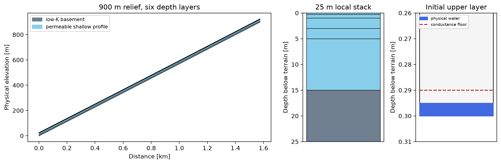

# Terrain-following 3D: API and scientific acceptance

Branch: **dev only**. Cartesian production 2D code was not modified.
The previous corrected Cartesian baseline is `5c2b985`.
The reference architecture is RichardsWarp `feature/scientific-audit-fixes`,
commit `3c77abb42e759b7696f061b89dab92692daa274f`, particularly
`fv3d/terrain_grid.py`, `terrain_reference.py`, `terrain_kernels.py`,
`terrain_gpu.py` and `docs/FV3D_TERRAIN.md`.

Environment: NVIDIA RTX 4070 Ti SUPER 16 GiB, Warp 1.17.0,
Python 3.14, FP64, MODFLOW 6 6.6.2. The terrain GMRES state adapts NVIDIA
Warp's Apache-licensed implementation and uses its private recorded kernels;
compatibility with other Warp versions needs validation. Cartesian imports
do not import the terrain backend.

Final implementation tested: `7223d7e`, preceded by logically separated
commits `51b2759`, `ef50bc3`, `94a0d88` and `e098def`.
The final complete `pytest tests -q` run passed **562 tests, zero failures,
zero skips**, in 668.50 s. All **20 live MODFLOW 6 comparisons ran**.
The 195 warnings are dependency deprecations/backend-selection warnings,
not skipped validation. The final focused terrain, storage, component and
actual-hierarchy regression run passed 181 tests.

## Confirmed defects, corrections and audit evidence

| Finding | Correction / evidence |
|---|---|
| Zero-cycle `head_rms_cached` UnboundLocalError | Disproved for the starting `dev` checkout: `_run_kcycles` already initialized it before the initial convergence test. Preserve that fix. Add exact hydrostatic, solved linear, unchanged transient, repeated-head, explicit zero-cycle and iteration-limit regressions. Zero-cycle head-change values now equal zero; empty-free-set exits also populate residual/graph/workspace diagnostics. |
| Storage inputs silently discarded or storage mode silently changed | `physics/storage_contract_3d.validate_unconfined_storage_inputs`: incompatible inputs raise; `storage_coeff` no longer implicitly changes secant Sy to legacy volume storage. Classic compatibility and live fast paths use the same contract. |
| Legacy transient previous state could change across Picard iterations | Resolve `head_prev` once from explicit initial heads before entering the shared driver. A source/storage-only cell independently verifies h_new=0.5+0.05/0.1=1 m on classic and fast. |
| Scalar Sy/Ss could bypass finite/nonnegative validation | Validate scalar and array inputs identically. Negative, NaN and infinite scalar Ss regressions. |
| Inner acceptance at default tolerance could produce zero updates and premature stagnation | Shared `_picard_unconfined_7point_3d` retries an apparently stationary inner solution at the requested final head tolerance. Check the undamped update as well as the accepted update; final rebuilt physical budgets remain authoritative. |
| Tiny elastic changes lost against larger yield potential | `physics/storage_3d.storage_increment_3d` factors the square difference. A one-ULP increment above a fully saturated layer retains elastic storage even when subtracting full W values returns zero. Nonzero representable displacements use secants without a 1e-12 m cutoff. |
| Terrain could be represented by offsetting tops/bottoms with the Cartesian stencil | Separate `build_from_terrain` geometry mode implements all transformed cross terms. Cartesian construction retains its flat, contiguous, uniform-dz validation. |
| A smaller dry floor might be mistaken for unsaturated physics | Default 3D floor becomes **0.01 m**. Storage remains unfloored. Three-floor sensitivity, true-dry transmission and independently rebuilt balances are reported separately. |
| Zero current storage tangent could reject valid Sy-only drainage or dry rewetting | `seed_zero_capacity_state_3d` inverts the integrated storage law for a numerical initial guess. Classic/fast and terrain regressions retain the old physical state and verify the final source/storage balance. |
| Distinct coastal elevations could be stored without affecting flux | `TerrainReferenceOperator3D._validate_contacts` includes the subface centroid displacement in the head extrapolation, using the same tangential gradients as the metric flux. Pure vertical head gradients give zero lateral coastal flow even for contacts at different elevations. |
| A closed discharge-only boundary could be mistaken for a singular unconstrained component | `seed_discharge_only_components_3d` opens a branch through a numerical guess for positive net source. Balanced steady components still report an undetermined datum; negative net source cannot be supplied by a discharge-only boundary. Transient stored-water release remains valid. |

The earlier low-K identity, harmonic-mean, reciprocal-face, connected-component,
cache-mutation, geometry-contiguity, multigrid-transfer and original-source
regressions remain in the suite. No positive conductivity threshold is added.

## Geometry, equations and dimensions

Coordinates are xi=x, eta=y, zeta=S(x,y)-z. The mapping has unit Jacobian:
V_k=dx*dy*Delta_zeta_k. Common depth interfaces may be nonuniform; they follow
the supplied DEM, independently of its absolute elevation or catchment relief.
Active masks select complete columns. Geometry owns read-only DEM/interface
snapshots and caches the derivative operators.

For **total hydraulic head**, without a separate pressure-head gravity term,

```
A = [[Kx, 0, Kx*Sx],
     [0, Ky, Ky*Sy_slope],
     [Kx*Sx, Ky*Sy_slope, Kx*Sx² + Ky*Sy_slope² + Kz]]
(q_xi, q_eta, q_zeta) = -A grad_logical(h)
q_zeta = Sx*q_x_physical + Sy_slope*q_y_physical - q_z_physical
```

`Sy_slope` is a terrain derivative; specific yield is a distinct field.
Depth-normal flux is the flux through a sloping geological interface, not
the Cartesian vertical vector component. This distinction matters in dry
transmission diagnostics.

Each internal face has one authoritative flux. With half-cell normal
transmissibilities TL=aL/dL, TR=aR/dR, and tangential contributions bL/bR,

```
G  = TL*TR/(TL+TR)                 # evaluated using min/max ratios
wL = TR/(TL+TR); wR = TL/(TL+TR)
F  = area_logical * [G*(hL-hR) - wL*bL - wR*bR]
```

The host implementation uses NumPy gradients and sparse incidence/gradient
assembly. GPU kernels independently reconstruct gradients, evaluate shared
faces, and gather their divergence. No atomics or independent reverse-face
evaluation are needed. The resulting stencil contains the seven principal
neighbors and eight slope diagonals (15 positions).

Face DEM slopes use the same difference as normal head gradients. Cell DEM
slopes use the same centered/one-sided differences as tangential gradients,
including active-mask edges. For h=a*z+b, h_xi=a*Sx and h_zeta=-a, so lateral
metric terms cancel. Constant total head gives exactly zero physical flux.
Zero slope eliminates all cross terms and reduces to the Cartesian face law.

Units: K [m/day], A [m/day], grad(h) dimensionless, G [1/day],
face area [m²], conductance [m²/day], F and source [m³/day].
Recharge is rate*dx*dy, using horizontal map area without a slope multiplier.
Positive source injects water; positive outward flux removes water;
positive storage change is uptake.

## Saturation and conservative storage

For layer thickness d, b=clip(h-bottom,0,d) is physical saturation;
b_reg=clip(h-bottom,min(0.01,d),d) is numerical conductance saturation.
Construct the terrain tensor from physical diag(Kx*b_reg/d, Ky*b_reg/d, Kz).
Consequently horizontal and their associated cross terms share the same
regularization; transformed Azz also includes those horizontal metric terms,
while physical Kz remains saturation independent. This retains the Cartesian
quasi-3D convention and positive tensor structure; it is not Richards physics.

Default unconfined storage integrates

```
W(h) = Sy*b + Ss*[b²/2 + d*max(h-top,0)]   # per horizontal area [m]
Delta_W = Sy*(b_new-b_old)
        + Ss*[(b_new-b_old)*(b_new+b_old)/2 + d*(excess_new-excess_old)]
S_secant = area*Delta_W / [dt*(h_new-h_old)]   # [m²/day]
```

At exactly unchanged head use the physical tangent. The old head is fixed
for the whole timestep. Terrain uses each actual layer thickness; confined
storage is Ss*V_k*(h_new-h_old)/dt. The numerical floor creates no Sy/Ss
storage. Positive injection into an initially dry cell and drainage from a
fully saturated Sy-only cell seed only the nonlinear iterate using the
integrated capacity; the previous physical storage remains unchanged.
Exact final balances verify drying and rewetting.
The Cartesian compatibility field `effectively_dry_cell_count` remains a
near-bottom flag with its independently configurable 0.1 m threshold. It is
not the conductance floor or a claim of zero physical saturation. The
`dry_cell_approximation` diagnostics use unfloored saturation to identify
genuinely dry cells; terrain reports that physical count directly.

For every free cell, the independent final-head gate evaluates

```
source - sum(outward physical face fluxes) - area*Delta_W/dt = 0
```

Report the cell maximum/RMS and L1 imbalance before domain summation. A small
domain discrepancy cannot hide equal and opposite cell errors. Head-equivalent
RMS uses the positive physical principal diagonal, explicitly identified as
that scaling; small updates alone never establish acceptance. Terrain stops
when the independent volumetric and normalized physical gates pass.

## Public API and storage contract

Set `DARCY_FLOAT=float64` before importing DarcyWarp. Construction example:

```python
solver = WarpDarcySolver3D(nx=nx, ny=ny, nz=nz, dx=dx, dy=dy,
                          implementation="fast", device="cuda:0")
solver.build_from_terrain(
    surface_elevation=dem, zeta_faces=depth_interfaces,
    active_columns=catchment_mask,
    kx_field=kx, ky_field=ky, kz_field=kz,
    bc_mask=fixed_cells, bc_values=total_boundary_head,
    rhs=volumetric_sources, initial_head=starting_total_head,
    contacts=coastal_subfaces,
)
head, info = solver.solve(unconfined=True, transient=True,
    sy=specific_yield, ss=specific_storage, dt=duration_days,
    head_prev=previous_total_head, unconfined_min_sat=0.01)
```

Construction selects terrain explicitly. Scalar constructor dz is unused in
this mode. Unsupported geometry or controls raise rather than fall back to
Cartesian physics. `update_rhs`, `update_initial_head`,
`update_boundary_values`, `update_terrain_contacts`, `update_terrain_K_fields` and
`update_terrain_geometry` update the owned session. Geometry updates retain
shape; mask/topology changes reconstruct the hierarchy. Value changes refresh
stable GPU buffers. Arbitrary storage arrays passed to solve are read by
value, so in-place changes cannot reuse an old storage operator.

| Mode | Accepted physical storage inputs | Rejected combinations |
|---|---|---|
| Transient unconfined `secant_sy` (default) | Sy and/or Ss; positive dt; head_prev or explicit initial_head | storage_coeff, storage_diag |
| Cartesian legacy `phreatic_sy` | Sy, optional Ss, dt and prior state | storage_coeff, storage_diag; terrain rejects this nonconservative legacy mode |
| Explicit unconfined `confined_volume` | storage_coeff [1/m], dt and prior state | Sy/Ss, storage_diag |
| Confined terrain | storage_coeff [1/m], dt and prior state | Sy/Ss and preassembled storage_diag |
| Steady unconfined | No storage inputs | Sy/Ss/storage_coeff/storage_diag/head_prev/dt |

Cartesian confined compatibility retains its preassembled diagonal contract:
the caller provides its matching storage RHS; an additional storage_coeff
contribution is assembled with its own old-head RHS. Independent budgets
subtract only the declared preassembled old-head contribution, retaining the
original source. Terrain and unconfined APIs deliberately reject preassembled
diagonals until an unambiguous additive contract is supported.

`TerrainContact3D` preserves each exterior subface's owner, orientation,
physical area, logical distance, elevation, tangential `x_offset`/`y_offset`,
total boundary head and optional integrated conductance. Tangential head
extrapolation to each centroid uses its actual logical depth and horizontal
offsets. Offsets must stay within the owning face; top/bottom elevations must
match the supplied logical distance. Top/bottom physical areas are projected to map area
for the transformed flux. Prescribed-head and discharge-only contacts use
the same corrected flux in solver and budget; discharge-only suppresses
inflow. Internal contacts, inactive owners, fixed-cell/contact double counting,
invalid values and excess summed exterior areas raise. Distinct coastal
contacts are never averaged into a cell-centre condition. Boundary-head
updates reuse the operator; conductance/centroid changes refresh values,
and open/closed contact topology may rebuild the hierarchy. No-flow is the
explicit default on other exterior faces.

Nonflat flowing terrain or explicit coastal contacts currently require
strictly positive Kx/Ky/Kz on active cells. This is an exact-zero validation,
not a small-K cutoff. Mixed exactly-zero materials require an impermeable
interface/tangential-gradient closure beyond this implementation; accepting
them would otherwise allow tangential gradients to read unconstrained heads.
Flat terrain without contacts retains mixed zero-material Cartesian reduction;
an entirely zero-conductivity storage-only domain is also supported. Genuine
impermeable regions in flowing terrain should use the supported active-column
mask, without replacing zero conductivity with an artificial positive value.

## GPU solver and hierarchy

`solvers/terrain_fast_3d.TerrainGPUWorkspace3D` owns persistent FP64 gradients,
face coefficients, fluxes, RHS, solution, masks, storage, contact buffers,
multigrid levels and Krylov arrays. A full restarted GMRES correction block
is captured once and replayed across iterations, nonlinear updates and
repeated solves. There are no per-Krylov-iteration field transfers or GPU
allocations; scalar norms cross the device at restart checks. The existing
Cartesian K-cycle remains a separate backend.

Right preconditioning uses a fixed linear V-cycle on the seven-point
principal tensor part. Actual block restriction and bilinear prolongation
are the existing horizontal semi-coarsened operators. This is a conservative
approximate hierarchy, **not exact Galerkin**. The full physical operator,
including cross derivatives, is always used for GMRES and acceptance.
Positive diagonal row scaling makes low-conductivity head errors visible;
inner tolerances are bounded by the requested independent flow-budget gate.
No identity equation replaces a small positive groundwater equation.

The nonlinear driver retains secant Picard with exact-budget backtracking.
It can be expensive near sharp capacity switches and numerical drying.
It reports iteration-limit nonconvergence; it does not relax scientific gates
to produce a successful timing row.

## Independent acceptance evidence

Analytical checks cover flat reduction, constant total head, independent
x/y/vertical and combined physical gradients, all six exterior orientations,
nonuniform layers, irregular masks, datum shifts, internal conservation,
heterogeneous low-K basement and vertical anisotropy down to Kz/Kx=1e-4.
Uniform K/source scaling at 1, 1e-14 and 1e-80 preserves terrain steady heads.
The CPU sparse stencil is checked against independent face divergence and
its actual 15-position support. GPU matvecs and faces are checked for both
confined and regularized unconfined operators against this sparse reference
(2e-13 absolute + 3e-13 relative gates). Fine heads match manufactured
references within 2e-7 m, with principal-normalized residual RMS <1e-9 m.

A continuous calculus-based manufactured source on 900 m sinusoidal terrain
shows second-order refinement at nx=16,32,64 (error decreases by more than
threefold on each doubling). It does not set source=A_discrete*h.
Closed storage tests independently integrate differing Sy across layers,
elastic confinement, drainage, complete drying and rewetting. True-dry
transmission is tested at floors 0.1,0.01,0.001 m, including a 0.05 m upper
layer and 1e-14 basement contrast. Original-source roundoff tests reject
unresolved ±1 m³/day forcing despite zero summed domain imbalance.

**Live MF6 tests ran.** Equivalent flat-terrain histories compare common
initial heads, fixed boundaries, RCH/WEL histories, Sy/Ss, durations and times
[1,4,11,13] days. Heads, water tables, every face family, cell storage and
global package budgets use the existing gates: heads 2e-5 m; flux/storage
2e-5 m³/day absolute + 2e-5 relative; independent cell conservation 2e-7
m³/day. Terrain maximum head differences were 1.08e-11 m confined,
1.2e-9 m drainage/recharge restart and 5e-9 m over basement; corresponding
maximum face differences were 3.27e-10,1.09e-7,2.32e-7 m³/day.
Different-Sy layer crossings also compare matched MF6 periods.
The 20 live MF6 tests include the retained Cartesian validations.
Unavailable MF6 produces explicit pytest skips, never a synthetic pass.

Sloping terrain is validated by physical analytical/manufactured fields and
independent sparse equations. It is not compared to a non-equivalent MF6
Cartesian grid as evidence of identical physics. MF6 Newton smoothing and
the clipped storage potential remain different constitutive laws near
convertible-cell transitions; the prior independent smoothing-law/root
tests and documented differences remain in force. Tolerances were not widened.

## Measured results and remaining limitations

Timing, memory, exact independent residuals, graph counts, floor-induced head
and discharge differences are recorded in
[`3d_terrain_benchmarks64.json`](3d_terrain_benchmarks64.json) and
[`3d_terrain_cartesian_regression256.json`](3d_terrain_cartesian_regression256.json).
The final acceptance summary is
[`3d_terrain_acceptance_results.json`](3d_terrain_acceptance_results.json).
The benchmark script keeps every adjustable setting in its main block.
First solve includes workspace/graph setup; repeated solves reuse them.
Imports and the separately recorded geometry construction are outside these
solve timings. Warp's compiled kernel cache is warm; compilation cost is not
presented as groundwater-solve performance.
GPU memory deltas are process mempool allocations; high-water marks are
process-wide and are not a new allocation on each solve. Benchmark regimes
have different physical boundary fields in Cartesian and terrain modes;
their times are separate measurements, not a speedup ratio for equal systems.

The earlier isolated 393,216-cell Cartesian comparison against corrected baseline
`5c2b985` uses identical coefficients, source fields and controls. Four solves
separate setup from repeated execution. No graph capture failed, and repeated
solves retain graph/buffer ownership. Recorded repeated medians were within
0.6% of baseline across all five regimes; this is ordinary timing variation,
not evidence of a speed improvement.

| Cartesian regime, 6x256x256 | First solve [s] | Repeated median [s] | Baseline repeated [s] | Total inner cycles |
|---|---:|---:|---:|---:|
| Confined steady | 0.285 | 0.161 | 0.161 | 35 |
| Confined transient | 0.244 | 0.165 | 0.166 | 35 |
| Unconfined steady | 2.495 | 2.492 | 2.502 | 435 |
| Unconfined transient | 2.556 | 2.572 | 2.584 | 430 |
| Heterogeneous layered transient | 1.909 | 1.873 | 1.862 | 240 |

At 4x64x64, the terrain measurements below include one first solve and two
repeated solves from the earlier isolated run, preserved in
[`3d_terrain_isolated_timings64.json`](3d_terrain_isolated_timings64.json).
These preceded the final zero-capacity/coastal guards, which do not change
the benchmark coefficients or iteration counts. The persistent allocation
delta is 8.11 MiB, versus 2.79 MiB
for the separately measured Cartesian cases. Every terrain case captures one
GMRES graph and reuses it. Krylov counts include all nonlinear iterations;
the corresponding fixed V-cycle counts are recorded separately in the JSON.

| Terrain regime | First / repeated [s] | Krylov / outer iterations | Independent cell RMS [m³/day] | L1 / throughput | Sparse head error [m] |
|---|---:|---:|---:|---:|---:|
| Confined steady | 0.068 / 0.029 | 84 / 1 | 7.25e-11 | 5.93e-11 | 1.63e-10 |
| Confined transient | 0.051 / 0.025 | 72 / 1 | 1.13e-9 | 8.78e-10 | 2.55e-9 |
| Unconfined steady | 0.543 / 0.483 | 960 / 18 | 9.99e-9 | 3.70e-9 | 1.76e-9 |
| Unconfined transient | 0.389 / 0.372 | 480 / 17 | 3.26e-8 | 5.89e-9 | 2.17e-9 |
| Layered transient | 0.299 / 0.283 | 420 / 17 | 2.69e-8 | 5.40e-9 | 1.99e-9 |

The independent frozen-coefficient SciPy solve is performed after timing, with
the same 2e-7 m head-error gate for every terrain case and every floor. It
assembles storage independently of the GPU solver. These checks complement
the continuous manufactured-source refinement and independent final budgets;
agreement with a frozen system alone does not establish a nonlinear storage law.

A final rerun at `7223d7e` encountered a separate `shanz` Python GPU workload
(2472 MiB, independently observed using the GPU). It passed all physical
gates and retained identical iteration counts, but its times are **contended**.
Those raw measurements are retained in `3d_terrain_benchmarks64.json` and
[`3d_terrain_cartesian_contended256.json`](3d_terrain_cartesian_contended256.json).
They cannot establish a solver performance regression against an isolated
baseline. No other workload was stopped or modified. The benchmark records
other compute processes to make future timing contention visible.

| Final terrain case under contention | First [s] | Repeated [s] |
|---|---:|---:|
| Confined steady | 0.117 | 0.066 |
| Confined transient | 0.088 | 0.058 |
| Unconfined steady | 0.999 | 0.947 |
| Unconfined transient | 0.626 | 0.591 |
| Layered transient | 0.717 | 0.633 |
| Representative 0.01 m floor | 10.908 | 10.871 |

The final isolated wall-time comparison requires an idle GPU. The evidence
available here establishes retained operators, graph/buffer reuse, physical
residuals and iteration counts; it does not infer a wall-time change from
the contended rerun.

The representative case is **synthetic**, Purau/Orton Bradley-style, not a
calibrated SHANZ model: 64x64 columns at 25 m spacing, 900 m relief,
irregular footprint, depth interfaces [0,0.3,1,3,5,15,25] m and basement
K=1e-7 m/day (Kz=1e-8) below 15 m. Six depth layers represent 25 m of local
profile despite 925 m total physical elevation span. The 0.3 m upper layer
starts with only 0.005 m saturation. Recharge/abstraction and storage are
identical throughout the floor sweep; each final head has an independently
reconstructed flux/storage budget. Surface-exchange head is reported as a
potential, not an imposed atmospheric or Richards exchange flux.



| Floor [m] | First / repeated [s] | Krylov / outer | Cell RMS / max [m³/day] | Domain imbalance [m³/day] | Independent head error [m] |
|---|---:|---:|---:|---:|---:|
| 0.1 | 6.46 / 6.91 | 4440 / 237 | 2.86e-6 / 5.89e-5 | 0.00532 | 1.19e-7 |
| **0.01** | **6.75 / 7.04** | **4704 / 248** | **2.51e-6 / 1.19e-5** | **0.00551** | **2.48e-8** |
| 0.001 | 7.04 / 7.08 | 4932 / 266 | 1.04e-6 / 4.87e-5 | 0.00122 | 1.09e-7 |

The timing columns in this floor table are the earlier isolated run. Final
physical statistics are unchanged within reduction roundoff; the contended
rerun independently repeats the sparse validation at all three floors.

The default representative run retains one graph, uses 12.07 MiB of solver
arrays, and has principal-normalized residual RMS 2.80e-10 m and cell L1 /
gross throughput 4.58e-9. Its signed global imbalance is about 0.0026% of
recharge. Roughly 3 s of a repeated solve is host operator/storage/budget
refresh; Krylov execution itself retains stable device buffers. These are
visible nonlinear/refresh costs, not concealed by excluding them from timing.

Same-head floor excess is the sum of absolute face-flux differences from an
unfloored evaluation. It is a transmission perturbation, not net water creation.
Relative to the default final solution:

| Floor [m] | Max head change [m] | Max water-table change [m] | Change in net outward boundary discharge [m³/day] | Horizontal floor excess / recharge | Horizontal excess / imposed pump | Layer-normal floor excess / throughput |
|---|---:|---:|---:|---:|---:|---:|
| 0.1 | 0.00776 | 0.00406 | -55.98 | 12.86 | 1.38e5 | 0.00519 |
| **0.01** | 0 | 0 | 0 | **0.6775** | **7292** | 0 |
| 0.001 | 0.000135 | 0.000135 | +1.422 | 0 | 0 | 0 |

The imposed pump is only 0.02 m³/day and occurs in a cell that also receives
recharge; its ratio is kept separate from net cell abstraction, which is zero
in this setup. The default horizontal excess is 145.83 m³/day, just 2.22e-5
of gross throughput, yet 67.75% of recharge. The 0.1 m floor produces
2768.47 m³/day of horizontal and 34318.10 m³/day of layer-normal metric excess.
At 0.001 m no cells in this final case fall below the floor. None of these
zero excess values establishes physically correct unsaturated vertical flow.
The representative starts near dry, then rewets; it has no completely dry
final cells. Separate controlled true-dry tests retain measurable vertical
flow through the saturation-independent physical Kz law at all three floors.

Reducing 0.01 to 0.001 m moves the highest surface-exchange head potential from
-0.147808 to -0.147940 m below terrain. The measured 0.135 mm water-table and
1.42 m³/day discharge differences may be small for some applications; the
large recharge-relative transmission perturbation means this case cannot
support a general claim of accurate dry-cell flow. Boundary near-dry columns
remain part of the floor-sensitive system.

The floor is sufficiently accurate only when saturated thickness exceeds the
floor throughout relevant connections, or independently measured excess
flows and floor-induced head/discharge changes meet the application's
accuracy requirements. Full saturation gives zero floor perturbation. Near
layer bottoms, even a small fraction of gross budget throughput can be a
large fraction of recharge or abstraction. The report must assess both.

Remaining limitations: quasi-3D dry transmission and saturation-independent
physical Kz; no capillarity, unsaturated relative conductivity or full
dry-cell deactivation; common parallel depth interfaces only; complete active
columns only; at least two layers for nonflat terrain; no variable local
thickness, pinches or nonparallel contacts. The hierarchy is approximate.
Host Picard refresh/budget work and steep drying iteration costs remain
visible. Host boundary packing iterates supplied physical subfaces; very
large coastal-contact lists have not been benchmarked. A small numerical
residual verifies the equations that were solved,
not the physical validity of a numerical dry-cell approximation.
Geometry can be updated between solves, but moving-grid storage remapping is
not implemented; prior heads/storage must refer to the same static geometry
within each accepted timestep. Offset coastal subfaces require enough cells
to reconstruct their tangential gradients. Exactly-zero material closures
in nonflat flowing terrain remain an explicitly rejected extension.

Reproduction (FP64 environment):

```bash
DARCY_FLOAT=float64 python -m pytest tests -q
DARCY_FLOAT=float64 python working_tests/benchmark_3d_terrain.py --out docs/3d_terrain_benchmarks64.json
DARCY_FLOAT=float64 python working_tests/benchmark_3d_scientific_audit.py --nx 256 --ny 256 --nz 6 --out docs/3d_terrain_cartesian_regression256.json
python working_tests/plot_3d_terrain_geometry.py
```

Run timings serially, separately from test/GPU workloads. Full-suite outcomes
and final benchmark provenance are recorded with the acceptance artifacts.
