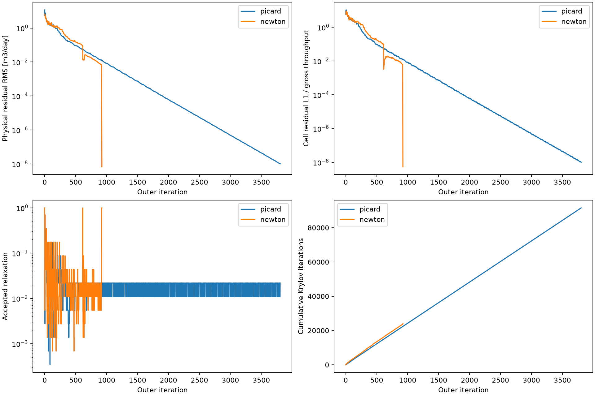

# Terrain Newton validation on 16 October 2026

The opt-in safeguarded Newton–Krylov path solves the original 64×64×4 low-K cold-start case in **924 outers, 23,976 Krylov iterations and a median 8.784 seconds**, compared with **3,804 outers, 91,560 Krylov iterations and 32.977 seconds** for converged Picard. This is a **3.75× measured reduction in time to accepted convergence** on the recorded runtime. Final head-equivalent RMS is `3.29589e-10 m`, physical RMS `6.84951e-9 m3/day`, and relative cell imbalance `5.43571e-9`. All original physical and head acceptance criteria pass under the original 2,000-outer/2,000-Krylov-per-outer caps.

The target low-K solution agrees with the longer-cap same-equation Picard solution: maximum head difference `7.223e-7 m`, head RMS difference `1.980e-8 m`, identical floor/gate states and maximum internal face-flux difference `4.868e-7 m3/day`. This is agreement between solutions of the same discretization, not independent physical-model validation.

**Scope and baseline.** Work began from `dev` at `d056eaf666268e3c5f3e0017c91d51c3160162de`, in the separate branch `fix/terrain-newton-krylov` and worktree `/tmp/darcy-terrain-newton`. The original checkout and unrelated untracked work were preserved. No push or merge was performed. Repository and parent AGENTS.md instructions were checked; no applicable nested AGENTS.md was found.

The available report `/tmp/darcy-low-k-diagnosis/docs/LOW_K_64_DIAGNOSIS_2026-10-15.md` was read. The separately requested `docs/TERRAIN_LOW_K_64_DIAGNOSIS_2026-10-15.md` was not present in the available repository/worktrees. Its contents were unavailable, not assumed equivalent to the available report.

The intended existing interpreter was `/home/patrickdurney/miniconda3/envs/darcywarp/bin/python`: Python 3.14.7, Warp 1.17.0, NumPy 2.3.5, FP64, CUDA device 0, NVIDIA GeForce RTX 4070 Ti SUPER with 16 GiB. Warp reported toolkit 12.9 and driver API 13.2; the NVIDIA driver was 595.91.07. Current environment files pin Warp 1.17.0 and Python 3.12; the installed interpreter differs from that canonical Python pin. No environment was installed or upgraded. Exact runtime and source hashes are in [runtime_revision.json](../audit_outputs/runtime_revision.json).

The original requested harness ran before implementation, with the exact cold case, `dx=dy=20 m`, four independent interfaces, 16,384 active cells, 16,192 free cells, Kx `[2,8,0.5,0.0001] m/day`, Ky/Kx 0.6, Kz/Kx 0.15, original recharge/coastal heads/three natural west discharge contacts, 0.01 m floor and zero storage. It reproduced the diagnosis: `converged=false`, `outer_budget`, 2,000 outers, 48,264 Krylov iterations, head RMS `3.944583e-7 m`, physical RMS `6.202167e-5 m3/day`, relative cell imbalance `6.008032e-5`. Its 17.489 seconds is a failed-run measurement and is **not** the denominator of the speedup above. The subsequent 4,000-cap Picard reference is a separately labelled converged comparison, not the fix.

**Implementation and public use.**

```python
head, info = solver.solve(
    unconfined=True,
    terrain_nonlinear_method="newton",
    unconfined_min_sat=0.01,
    unconfined_max_picard_iter=2000,
    max_cycles=2000,
    krylov_restart=24,
    max_levels=6,
    min_coarse_n=16,
    unconfined_relax=0.7,
    final_head_residual_tol=1e-6,
    abs_tol_min=1e-12,
    final_budget_relative_tol=1e-8,
    rel_tol=1e-12,
)
```

This is the normal `WarpDarcySolver3D` terrain-session API; it selects the device implementation without requiring a diagnostic wrapper. `terrain_nonlinear_method="picard"` retains the original method; `device_picard=True` selects its existing device path. Picard remains the default. The new path is **opt-in and experimental**, because the controls below expose material branch-selection differences. It supports steady unconfined terrain; confined/transient Newton requests raise explicitly. No 2D or Cartesian solver algorithm changed.

[terrain_newton_kernels.py](../DARCY_WARP_PACKAGE/solvers/terrain_newton_kernels.py) analytically differentiates the actual 13-coefficient conservative terrain faces and contact refresh law, including both coefficient and head-gradient contributions. [terrain_newton_3d.py](../DARCY_WARP_PACKAGE/solvers/terrain_newton_3d.py) owns private Jv scratch, persistent GMRES buffers/graphs within a solve, globalization and shared-budget Picard fallback. The existing multigrid Picard operator is a fixed right preconditioner. Newton solves the unscaled physical equations; its inner target has m3/day units, while Picard fallback retains its original head-scaled forcing. No derivative of a changing row scale is omitted: Newton uses identity scaling. The [derivation](TERRAIN_NEWTON_DERIVATION_2026-10-16.md) specifies signs, every conductance/contact dependence, active-set choices, constraints and preconditioner mapping.

Initial straightforward Newton policies were not adequate cold-start solvers: the first head-scaled inexact prototype exhausted 2,000 outers. Correct Jv alone did not remove the startup difficulty. The final method requires a reached linear target and substantial actual nonlinear merit reduction to continue Newton; weak attempts use Picard, then retry Newton after physical RMS halves. This is driven by status and residual progress, with no case identity or fixed outer-number switch.

For the main case, Newton is attempted on 13 outers and accepted on six: 1, 615, 921, 922, 923 and 924. All six accept full steps. The other 918 outers use Picard; this count includes 911 scheduled Picard outers, not 918 failed Newton solves. The improvement comes from eliminating the slow tail with correct directions while retaining Picard through difficult active-set regimes. It is not a claim of a uniformly rapid pure Newton method.

Final acceptance is unchanged: finite heads AND head-equivalent RMS <=1e-6 m AND (physical RMS <=1e-12 m3/day OR cellwise L1/gross throughput <=1e-8), using the existing tiny-throughput treatment. Small updates and signed domain imbalance do not establish convergence. No smoothing, artificial storage, K/floor/geometry changes, cold-start replacement or looser tolerance was introduced.

**Derivative and saved-state evidence.** New tests cover fully saturated, thinly saturated, floor-active and mixed cells; variable geometry; heterogeneous anisotropic horizontal/vertical connections; fixed-head projection and boundary exchange; natural/overridden open and closed contacts; selected one-sided floor/top/discharge kinks; conservative internal incidence; state integrity; exact shared-budget exhaustion; failed fallback restoration; and public session handoff. They run on CPU and CUDA. Smooth-state central differences use four perturbation sizes and require agreement before roundoff dominates. Kink tests use the selected branch rather than assuming smooth central differences across thresholds.

At the delivered accepted state immediately before historical outer 2,000, original nonlinear physical RMS is `6.227535e-5 m3/day`. These are offline diagnostics, not final cold-start inputs:

| Direction at the same accepted head | Linear accuracy | Work | Physical RMS ratio at full step | Ratio at relaxation 0.0109375 |
| --- | --- | --- | --- | --- |
| Existing Picard | head RMS 9.422770e-9 m | 24 Krylov | 9.86551 | 0.995927 |
| Accurate frozen Picard | head RMS 2.438040e-16 m | independent sparse direct solve | 11.87029 | 0.993487 |
| Analytic Newton | physical RMS 4.563296e-7 m3/day, target 3.113768e-6 | 24 Krylov | **0.00732798** | 0.989063 |

The Newton full-step merit ratio is `1.03751e-4`; it removes the demonstrated need for approximately 1% damping at this state. Independent finite differences at eps=1e-5 and 1e-6, with no floor transitions, agree with Jv to relative L2 `1.63e-9` and `3.72e-9`. Larger eps=1e-3/1e-4 cross three/one floor branches and are recorded separately, not mislabelled as smooth-derivative failures. [Checkpoint verification](../audit_outputs/verification/checkpoint_verification.json) contains full scans and [numerical directions](../audit_outputs/verification/checkpoint_directions.npz).

**Before and after cost.** Two-outer warmups for both paths precede sequential measured solves. GPU synchronization surrounds setup and solve timing. Primary low-K results are medians of three complete converged cold-start solves; no other GPU compute processes were observed at those sample boundaries. Picard samples are `[32.977,32.899,33.073] s`; Newton samples `[8.821,8.784,8.739] s`. The wall measurement includes each solver call's workspace preparation/graph capture and independent final acceptance, after compilation warmup; it excludes case construction and `build_from_terrain`, recorded separately. Inner-loop and outside-loop overhead timings are also recorded. This avoids attributing setup/compilation differences to nonlinear performance.

| Case | Picard / Newton outers | Picard / Newton Krylov | Median converged wall s | Result |
| --- | --- | --- | --- | --- |
| 64 low-K | 3804 / 924 | 91560 / 23976 | 32.977 / 8.784 | both pass |

All requested controls ran cold. Newton always used the original 2,000-outer cap. The separate Picard control references allow 8,000 outers: K=0.01 and 0.001 did not pass at 4,000, then converged at 4,063 and 4,285, respectively. These extended references are not changes to the new method's caps. Size controls at fixed dx change domain extent; they are not a spatial-refinement study.

| Size n×n×4 | Basement Kx | Picard / Newton outers | Picard / Newton Krylov | Observed wall s, Picard / Newton | Status |
| --- | --- | --- | --- | --- | --- |
| 64 | 0.1 | 859 / 307 | 20616 / 9216 | 6.771 / 3.117 | both converged |
| 64 | 0.01 | 4063 / 665 | 97776 / 18936 | 35.164 / 6.716 | both converged |
| 64 | 0.001 | 4285 / 556 | 102888 / 15816 | 37.430 / 5.634 * | both converged |
| 16 | 0.0001 | 1313 / 183 | 32352 / 5760 | 9.166 / 1.608 * | both converged |
| 32 | 0.0001 | 1955 / 666 | 47520 / 20268 | 13.825 / 5.992 * | both converged |
| 96 | 0.0001 | 1863 / 342 | 44832 / 10104 | 18.838 / 4.188 * | both converged |

`*` marks control pairs with other GPU jobs observed at a sample boundary. Their times are disclosed observations, not isolated speedup measurements; the primary low-K speedup uses only the uncontended three-pair series. Earlier development/validation samples overlapped regression jobs and are excluded from timing conclusions. Process observations are saved in every final benchmark row; boundary observations do not constitute continuous utilization monitoring.

The complete measured work below is for one primary repeat and every control. Jv includes executed linear residual-check products as well as Arnoldi products. Device nonlinear evaluations include accepted-state refreshes/restoration; the session additionally performs independent host initial/final assembly and final physical validation. Candidate counts include trials later discarded for Picard fallback. Picard itself has zero analytic-Jv and fallback counts. Setup/final verification costs are included in wall time, not hidden in a Krylov-only timing.

| Case and method | Outers | Krylov | Jv | Device nonlinear evals | Candidates | Backtracks | Picard outers |
| --- | --- | --- | --- | --- | --- | --- | --- |
| 64 low-K picard | 3804 | 91560 | 0 | 28547 | 24724 | 20920 | 0 |
| 64 low-K newton | 924 | 23976 | 1658 | 7445 | 6471 | 5547 | 918 |
| 64, K=0.1, Picard | 859 | 20616 | 0 | 4741 | 3882 | 3023 | 0 |
| 64, K=0.1, Newton | 307 | 9216 | 2043 | 1958 | 1622 | 1315 | 299 |
| 64, K=0.01, Picard | 4063 | 97776 | 0 | 30084 | 25995 | 21932 | 0 |
| 64, K=0.01, Newton | 665 | 18936 | 3013 | 4992 | 4297 | 3632 | 659 |
| 64, K=0.001, Picard | 4285 | 102888 | 0 | 32296 | 28001 | 23716 | 0 |
| 64, K=0.001, Newton | 556 | 15816 | 2603 | 4131 | 3553 | 2997 | 549 |
| 16, K=0.0001, Picard | 1313 | 32352 | 0 | 13662 | 12001 | 10688 | 0 |
| 16, K=0.0001, Newton | 183 | 5760 | 1256 | 1717 | 1489 | 1306 | 176 |
| 32, K=0.0001, Picard | 1955 | 47520 | 0 | 13789 | 11802 | 9847 | 0 |
| 32, K=0.0001, Newton | 666 | 20268 | 4375 | 5422 | 4708 | 4042 | 660 |
| 96, K=0.0001, Picard | 1863 | 44832 | 0 | 13009 | 11143 | 9280 | 0 |
| 96, K=0.0001, Newton | 342 | 10104 | 2199 | 2170 | 1819 | 1477 | 334 |

The untouched physical gates at each control's returned head are:

| n | Basement Kx | Method | Head RMS m | Physical RMS m3/day | Cellwise relative imbalance |
| --- | --- | --- | --- | --- | --- |
| 64 | 0.1 | Picard | 7.320906e-11 | 9.789514e-09 | 9.355531e-09 |
| 64 | 0.1 | Newton | 1.064395e-10 | 1.050410e-08 | 8.595222e-09 |
| 64 | 0.01 | Picard | 7.029649e-11 | 1.019796e-08 | 9.907474e-09 |
| 64 | 0.01 | Newton | 2.549972e-11 | 1.487592e-09 | 8.633745e-10 |
| 64 | 0.001 | Picard | 6.850773e-11 | 8.996708e-09 | 9.959603e-09 |
| 64 | 0.001 | Newton | 2.740992e-10 | 1.381861e-08 | 6.544436e-09 |
| 16 | 0.0001 | Picard | 4.962010e-10 | 6.683992e-09 | 9.774200e-09 |
| 16 | 0.0001 | Newton | 9.022307e-11 | 1.568896e-09 | 2.573950e-09 |
| 32 | 0.0001 | Picard | 3.784342e-10 | 1.542726e-08 | 9.804753e-09 |
| 32 | 0.0001 | Newton | 1.910523e-10 | 9.267067e-09 | 7.547647e-09 |
| 96 | 0.0001 | Picard | 7.656450e-11 | 1.204910e-08 | 9.974386e-09 |
| 96 | 0.0001 | Newton | 1.192694e-11 | 3.470587e-10 | 5.632197e-10 |

**Solution comparisons and material limitations.** Independent host flux reconstruction was performed at every returned head, with original source and zero storage. All 18 measured final runs independently pass their reported physical gates and obey the shared Krylov limit. Warmups are excluded. Reference agreement is evaluated on head, internal/contact fluxes, cellwise residuals and floor/gate states.

| Newton run vs Picard reference | Max head difference m | Head RMS difference m | Max internal flux difference m3/day | Floor-state differences | Gate differences |
| --- | --- | --- | --- | --- | --- |
| control_newton_16_0.0001 | 2.721870e-07 | 2.992192e-08 | 6.328408e-08 | 0 | 0 |
| control_newton_32_0.0001 | 1.568392e+00 | 1.096668e-01 | 6.696804e+00 | 15 | 0 |
| control_newton_64_0.001 | 1.211988e-01 | 2.211629e-03 | 6.278861e-01 | 1 | 0 |
| control_newton_64_0.01 | 2.682661e-01 | 4.515492e-03 | 1.594903e+00 | 1 | 0 |
| control_newton_64_0.1 | 8.143117e-01 | 2.994068e-02 | 4.045355e+00 | 12 | 0 |
| control_newton_96_0.0001 | 3.050248e-08 | 5.429994e-09 | 3.183397e-07 | 0 | 0 |
| low_k_newton_0 | 7.222883e-07 | 1.980048e-08 | 4.867085e-07 | 0 | 0 |

For the main low-K comparison, contact-flux difference is at most `5.76e-14 m3/day`, and cell-residual RMS difference is `1.24e-8 m3/day`, consistent with the two accepted physical RMS values. No floor or contact gate changes remain between these solutions. The 16 and 96 low-K controls also agree closely.

The ordinary-K, 1e-2, 1e-3 and 32-size controls show material head/flux differences even though both methods pass. These differences were investigated using **verification-only warm starts and stricter tolerances**, not used to pass the cold-start benchmark. Each converged head was separately polished for up to 100 additional Newton outers with head tolerance 1e-10 m, physical tolerance 1e-14 m3/day and relative tolerance 1e-12. Independent reconstruction gives physical RMS around 1e-12 m3/day, while the differences and different floor branches persist:

| Control branch comparison after polishing | Max head difference m | Floor differences | Physical RMS, Picard-seeded / Newton-seeded | Strict polish stop reasons |
| --- | --- | --- | --- | --- |
| control_newton_32_0.0001 | 1.568392 | 15 | 4.923e-13 / 5.593e-13 | outer_budget / outer_budget |
| control_newton_64_0.001 | 0.121199 | 1 | 9.700e-13 / 5.758e-13 | outer_budget / outer_budget |
| control_newton_64_0.01 | 0.268266 | 1 | 8.493e-13 / 6.125e-13 | outer_budget / outer_budget |
| control_newton_64_0.1 | 0.814312 | 12 | 1.928e-12 / 1.279e-12 | outer_budget / outer_budget |

The strict polishing experiments are reported with their actual failure/success labels; reaching a numerical residual floor is not a passing result under those stricter gates. For ordinary K, the maximum difference is in cell `(0,53,26)`: its head lies about 4.46 m below the layer bottom in the Picard-seeded state and 3.64 m below it in the Newton-seeded state. The overall pair has 12 different floor branches. The discrepancy therefore is not explained by the original stopping-tolerance width. These are numerical evidence of different near-roots/branches of the existing floor/metric discretization; no mathematical uniqueness theorem or physical branch-selection validation was obtained. This is a material limitation and the reason to retain the new path as experimental and selectable. It would be incorrect to claim interchangeable solutions for every control, or to call this a universally validated replacement.

**Safeguards and state safety.** Newton and Picard share one per-outer Krylov counter. Newton may spend at most 75%, reserving at least a restart where possible; fallback receives exactly the unspent work. Adaptive refinements and shortened blocks are charged. Tests force exact exhaustion at budgets 0, 1, 13 and 25 and verify honest failure and unchanged accepted heads/residuals. A regression covers retaining an acceptable Newton candidate when Picard's linear fallback is unusable. Jv uses private device scratch and cannot mutate accepted operators or hierarchy. Every candidate gets a full nonlinear refresh, and rejected/retained states rebuild all derived fields before reuse. The final accepted head is checked through the independent host budget, without trusting pre-update or rejected-candidate norms.

Production head, conductance, residual, coefficient derivatives, Jv and preconditioner work stay on device throughout the nonlinear/Krylov loop. Only scalar reductions/norms cross per outer/restart, plus one Jv counter at the end. Full-field transfers and sparse matrices in `verify_terrain_newton.py` are explicitly offline verification.

**Validation and reproducibility.** The final affected suite has **1,152 passed tests**, with two Warp ctypes deprecation warnings. It covers the new CPU/CUDA tests; all terrain reference, GPU, GMRES, device Picard, contact exchange/stencil/lateral, runtime, scientific-audit and SHANZ diagnostics tests; existing 3D solver tests; and the reference 2D semismooth Newton tests. The full repository suite was not run. No MF6 stress-case validation, independent physical-model validation, uniqueness proof, transient Newton implementation or promotion of the default solver is claimed.

Delivery consistency checks also pass: 111 checks cover all final physical gates, shared work totals, complete trials, tested-source hashes and report links; see [delivery_validation.json](../audit_outputs/delivery_validation.json).

The exact original command and all final validation commands are in [commands.sh](../audit_outputs/commands.sh). Run new standalone scripts from the repository root using the recorded interpreter and `DARCY_FLOAT=float64 PYTHONPATH=.:working_tests`; their controls are direct configuration in the exact execution guard, without argparse or a `main()` wrapper. [benchmark_terrain_newton.py](../working_tests/benchmark_terrain_newton.py) generates warmups, three complete primary pairs and the control ladder. [verify_terrain_newton.py](../working_tests/verify_terrain_newton.py) uses the delivered checkpoint and normal numerical artifacts, performs independent final checks, same-state directions and the labelled polishing experiments. [summarize_terrain_newton.py](../working_tests/summarize_terrain_newton.py) regenerates tables' source data and the figure.

- [Benchmark summary and full counts](../audit_outputs/benchmark_summary.json); raw per-run JSON, full histories and head NPZs in `audit_outputs/validated`.
- [Independent final acceptance](../audit_outputs/verification/final_acceptance.json), [field comparisons](../audit_outputs/verification/solution_comparisons.json), and per-run residual/face/contact/floor/gate NPZs.
- [Strict polishing checks](../audit_outputs/polish/final_acceptance.json) and [branch comparisons](../audit_outputs/polish/solution_comparisons.json), preserving nonconverged labels.
- [Regression output](../audit_outputs/final_regressions.log), [Picard prefix preservation](../audit_outputs/picard_trajectory_check.json), source/runtime metadata and [checksums](../audit_outputs/SHA256SUMS).


