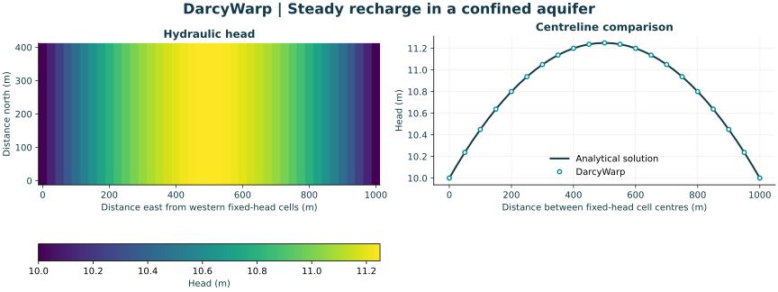

DarcyWarp
=========

Fast groundwater flow modelling in Python, on CPU and NVIDIA GPUs.

DarcyWarp solves two-dimensional, thickness-integrated groundwater flow on
regular square grids. It supports confined and unconfined aquifers, steady and
transient simulations, spatially variable properties, recharge, prescribed
heads and general-head boundaries. Repeated solves can reuse model state for
scenario and ensemble work.

Start with a small CPU model, then choose the formulation and solver that match
your problem. The benchmark tools and MODFLOW 6 comparisons remain available
for reproducible numerical and performance assessment.

   The introductory confined recharge model and its analytical reference.
   This figure is generated by the runnable example; it is not field data.

.. toctree::
   :maxdepth: 2
   :caption: Documentation

   quickstart
   capabilities
   validation
   benchmarking
   docs_build
   license

Find your starting point
------------------------

* :doc:`quickstart`: install the environment and run a synthetic recharge model.
* :doc:`capabilities`: understand the model, boundary conditions and solver choices.
* :doc:`validation`: find analytical checks, numerical tests and MODFLOW comparisons.
* :doc:`benchmarking`: reproduce recharge and transmissivity ensembles and plots.
* :doc:`docs_build`: build this documentation locally.

Repository map
--------------

.. list-table::
   :header-rows: 1
   :widths: 30 70

   * - Location
     - Contents
   * - ``DARCY_WARP_PACKAGE/``
     - Public factory, model construction, solvers and benchmark utilities.
   * - ``examples/``
     - Small runnable models with explicit inputs and outputs.
   * - ``tests/``
     - Numerical and API tests, including saved unconfined reference fixtures.
   * - ``working_tests/``
     - Larger comparison, transient replay and diagnostic workflows.
   * - ``data/`` and ``DARCY_WARP_PACKAGE/data/``
     - Retained comparison results and benchmark data.
   * - ``source/``
     - Sphinx documentation source.

The public ``main`` branch provides the 2D solver. Experimental 3D work on
``dev`` is outside the scope of this guide.

Development and citation
------------------------

See the repository's
`contribution guide <https://github.com/Lincoln-Environmental/DarcyWarp/blob/main/CONTRIBUTING.md>`_
for development checks and
`citation metadata <https://github.com/Lincoln-Environmental/DarcyWarp/blob/main/CITATION.cff>`_
when referencing the software. Record the commit used for numerical results.
